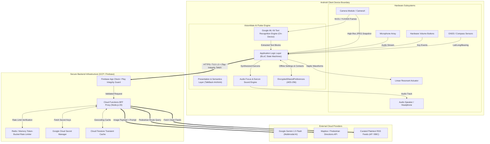
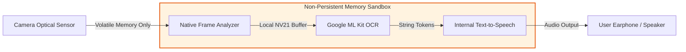
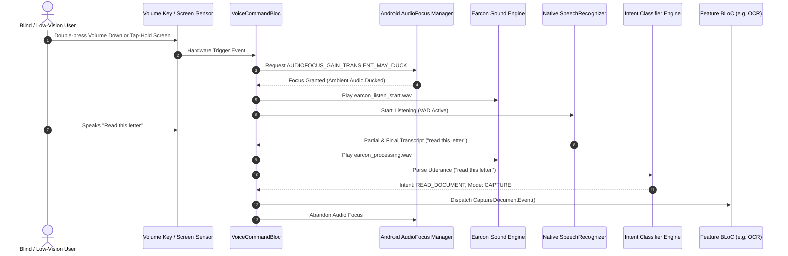
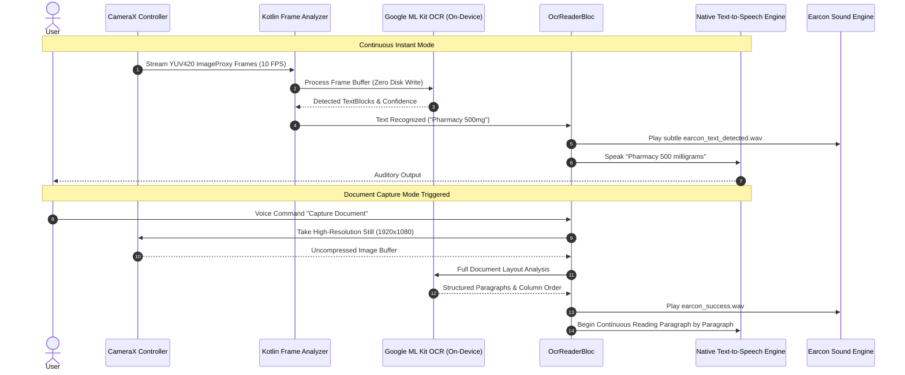
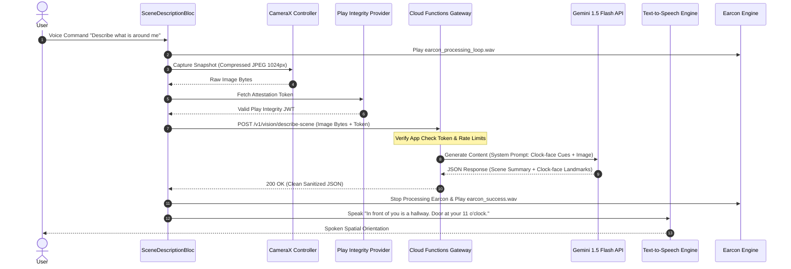
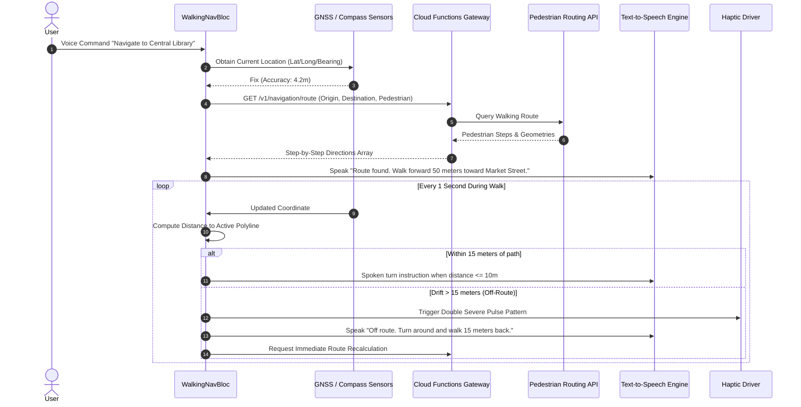
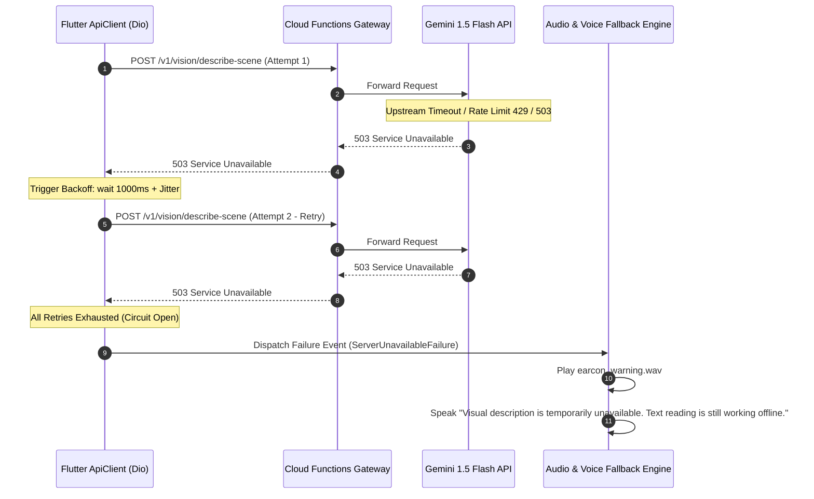

# VisionMate AI — Technical Requirements Document (TRD)

**Document Version:** 1.0.0  
**Document Status:** Approved Engineering Architecture & Specification  
**System Target:** Android (API Level 26+ / Android 8.0 through Android 15), Flutter 3.x, Dart 3.x  
**Development Host Environment:** Windows 10/11 x64, Antigravity IDE, Android Studio Ladybug / Koala, Android SDK (Build Tools 34.0.0+)  
**Target Release:** MVP Phase 1 (Core Voice, On-Device OCR, Cloud Scene AI, SOS) & Phased Navigation  
**Primary Source Baseline:** [VisionMate AI Product Requirements Document (PRD v1.0.0)](file:///c:/Users/SACHIN%20VERMA/OneDrive/Desktop/Nayan/docs/01_PRD.md)

---

## Table of Contents
1. [Technical Overview](#1-technical-overview)
2. [System Context and External Dependencies](#2-system-context-and-external-dependencies)
3. [Recommended Technology Stack & In-Depth Evaluation](#3-recommended-technology-stack--in-depth-evaluation)
4. [High-Level System Architecture](#4-high-level-system-architecture)
5. [Flutter Application Architecture](#5-flutter-application-architecture)
6. [Feature Modules and Responsibilities](#6-feature-modules-and-responsibilities)
7. [Frontend-to-Backend Communication](#7-frontend-to-backend-communication)
8. [API Integration Strategy (Backend-for-Frontend Proxy)](#8-api-integration-strategy-backend-for-frontend-proxy)
9. [Authentication and Authorization Requirements](#9-authentication-and-authorization-requirements)
10. [Camera, Microphone, and Location Permission Handling](#10-camera-microphone-and-location-permission-handling)
11. [Data Storage and Data Flow](#11-data-storage-and-data-flow)
12. [API Credential and Secret Management](#12-api-credential-and-secret-management)
13. [Error Handling and Retry Strategy](#13-error-handling-and-retry-strategy)
14. [Offline and Weak-Network Behavior](#14-offline-and-weak-network-behavior)
15. [Accessibility Engineering Requirements](#15-accessibility-engineering-requirements)
16. [Performance, Thermal, and Battery Considerations](#16-performance-thermal-and-battery-considerations)
17. [Privacy and Security Architecture](#17-privacy-and-security-architecture)
18. [Logging, Telemetry, and Crash Monitoring](#18-logging-telemetry-and-crash-monitoring)
19. [Testing Strategy](#19-testing-strategy)
20. [Build and Deployment Architecture](#20-build-and-deployment-architecture)
21. [Environment Configuration](#21-environment-configuration)
22. [Technical Risks and Mitigation Strategies](#22-technical-risks-and-mitigation-strategies)
23. [Technology Decisions Requiring Prototype Validation](#23-technology-decisions-requiring-prototype-validation)

---

## 1. Technical Overview

VisionMate AI is architected as an offline-first, voice-centric assistive mobile application targeting Android devices (with strict clean abstractions to facilitate future iOS cross-compilation). The technical foundation couples high-performance on-device machine learning (Google ML Kit on Android neural accelerators) for real-time, privacy-preserving optical character recognition with a secure, serverless Backend-For-Frontend (BFF) proxy for cloud-based multimodal visual reasoning (Gemini 1.5 Flash).

### Core Architectural Principles
* **On-Device vs. Cloud Separation:** Low-latency, privacy-sensitive tasks (instant sign/mail reading, document text extraction, volume-key Push-to-Talk, audio feedback) execute 100% on-device with zero network latency. Contextual visual Q&A and multi-step pedestrian routing execute via secure cloud proxies.
* **Zero Client Secrets:** Private API keys (Gemini API, mapping engines) are **never embedded** in the Flutter mobile application package. All third-party cloud services are brokered through a hardened serverless backend authenticated via hardware-backed device attestation (Firebase App Check with Google Play Integrity).
* **Strict Non-Visual Accessibility Layering:** Application state is mapped directly to a dual-channel sensory engine: an Auditory Earcon Synthesizer and a Waveform Haptic Driver, fully decoupled from visual rendering trees.
* **Pragmatic Serverless Backend:** To avoid unwarranted operational overhead, the backend does not use distributed microservices; it implements a unified, scalable Serverless Gateway on Firebase Cloud Functions (Node.js/TypeScript runtime) backed by Cloud Firestore.

---

## 2. System Context and External Dependencies

```
+------------------------------------------------------------------------------------------------------+
|                                    SYSTEM CONTEXT DIAGRAM                                            |
+------------------------------------------------------------------------------------------------------+
|                                                                                                      |
|  +------------------------+             Audio / Haptics / Touch                                      |
|  | Blind / Low-Vision     |<================================================+                        |
|  | User                   |================================================>|                        |
|  +------------------------+             Speech / Gestures / Camera Aim      |                        |
|                                                                             |                        |
|                                                                             v                        |
|  +------------------------------------------------------------------------------------------------+  |
|  |                            VISIONMATE AI FLUTTER CLIENT (Android)                              |  |
|  |                                                                                                |  |
|  |  +---------------------+   +-----------------------+   +------------------------------------+  |  |
|  |  | AudioFocus & STT/TTS|   | CameraX Video Stream  |   | On-Device Google ML Kit OCR Engine |  |  |
|  |  +---------------------+   +-----------------------+   +------------------------------------+  |  |
|  |  +---------------------+   +-----------------------+   +------------------------------------+  |  |
|  |  | Sensor & GPS Engine |   | TalkBack A11y Bridge  |   | Encrypted Local SharedPreferences  |  |  |
|  |  +---------------------+   +-----------------------+   +------------------------------------+  |  |
|  +------------------------------------------------------------------------------------------------+  |
|            |                                            |                              |             |
|            | Cellular / Phonebook                       | HTTPS / TLS 1.3              | HTTPS       |
|            v (Android OS Native)                        | Play Integrity               v             |
|  +--------------------+                     +-------------------------+      +---------------+       |
|  | Android OS Telecom |                     | VisionMate Backend Proxy|      | Open RSS News |       |
|  | (Emergency Calls   |                     | (Firebase Cloud Funcs)  |      | Feeds (BBC/   |       |
|  | & SMS Alerts)      |                     +-------------------------+      | NPR Plaintext)|       |
|  +--------------------+                                  |                   +---------------+       |
|                                         +----------------+----------------+                          |
|                                         |                                 |                          |
|                                         v                                 v                          |
|                            +-------------------------+       +-------------------------+             |
|                            | Google Gemini 1.5 Flash |       | Pedestrian Routing API  |             |
|                            | Multimodal AI Engine    |       | (Mapbox / Google Maps)  |             |
|                            +-------------------------+       +-------------------------+             |
+------------------------------------------------------------------------------------------------------+
```

---

## 3. Recommended Technology Stack & In-Depth Evaluation

Every technology chosen below is evaluated against: (1) What it does, (2) Why required, (3) Alternatives, (4) Limitations, (5) Pricing/Quotas, and (6) Dependency Risks.

### 3.1 Mobile Framework: Flutter SDK & Dart Language
* **What it does:** Provides a reactive, high-performance, single-codebase UI and logic platform compiled directly to native ARM64 machine code.
* **Why required:** Enables rapid prototyping, clean custom accessibility widget hierarchies, consistent 60 FPS animation/rendering pipelines, and robust platform-channel bindings to Android native audio and camera subsystems.
* **Alternatives:** Native Android (Kotlin + Jetpack Compose), React Native, .NET MAUI.
* **Limitations:** Dynamic text resizing and TalkBack semantics require deliberate engineering (`Semantics` widgets) compared to native Android XML/Compose which inherits OS defaults automatically.
* **Pricing / Quotas:** Free and open source (BSD-3 License).
* **Risks:** Dependency on Flutter team for timely support of bleeding-edge Android 15 accessibility and CameraX APIs (mitigated by custom native Kotlin MethodChannels).

### 3.2 On-Device Optical Character Recognition: Google ML Kit (Text Recognition v2)
* **What it does:** Runs quantized convolutional and recurrent neural networks directly on the device's CPU/GPU/NPU to detect and transcribe Latin text from camera video frames.
* **Why required:** Meets the strict PRD requirement (`FR-011`, `NFR-001`) of sub-second (< 800 ms) text-to-speech output without requiring an internet connection. Protects user privacy by ensuring paper mail, IDs, and medicine labels never leave volatile memory.
* **Alternatives:** Tesseract OCR (open source), Cloud Vision API, Apple Vision framework (iOS only).
* **Limitations:** Lower accuracy on distorted cursive handwriting; does not interpret spatial layout semantics (e.g., complex multi-column newspaper layouts require custom heuristics).
* **Pricing / Quotas:** 100% free; unlimited on-device inference; zero cloud API quota.
* **Risks:** Google bundle size footprint (+12 MB to APK); variation in inference latency across low-end vs. high-end Android chipsets.

### 3.3 Multimodal AI Reasoning: Google Gemini 1.5 Flash (via Backend Proxy)
* **What it does:** Processes downsampled visual snapshots paired with structured prompt templates to generate 2-sentence conversational scene descriptions, spatial clock-face orientations, and follow-up visual Q&A.
* **Why required:** On-device edge models (e.g., MobileNet) only classify single objects. Gemini 1.5 Flash provides deep relational scene understanding (e.g., *"There is a hallway at your 12 o'clock with an open door on the left"*).
* **Alternatives:** OpenAI GPT-4o mini, Anthropic Claude 3.5 Haiku, on-device Gemini Nano.
* **Limitations:** Requires active 4G/5G/Wi-Fi connection; latency of 1.5–3.0 seconds; cannot be used for time-critical real-time obstacle avoidance.
* **Pricing / Quotas:** ~$0.00001875 per image / $0.075 per 1M input tokens. Generous free tier during development (15 RPM).
* **Risks:** Potential cloud outages; network latency degradation; upstream provider policy changes regarding image processing terms.

### 3.4 Speech Recognition (STT) & Speech Synthesis (TTS)
* **What it does:** Transcribes spoken user commands (`speech_to_text` / Android native `SpeechRecognizer`) and vocalizes application feedback (`flutter_tts` / Android `TextToSpeech` engine).
* **Why required:** Core foundation of the voice-first paradigm (`FR-001`, `FR-007`). Eliminates reliance on complex visual touchscreen navigation.
* **Alternatives:** Cloud STT/TTS (Google Cloud Speech, ElevenLabs, Whisper Cloud), local ONNX Whisper (Sherpa-ONNX).
* **Limitations:** Native Android `SpeechRecognizer` requires continuous audio focus negotiation and can be interrupted by OS notifications; native TTS voice quality varies across budget OEMs.
* **Pricing / Quotas:** Free (uses operating system native engines built into Android).
* **Risks:** User devices without Google Speech Services installed may require graceful fallback to tactile tap interactions.

### 3.5 Backend Gateway: Firebase Cloud Functions (TypeScript / Node.js 20)
* **What it does:** Serves as a stateless Backend-For-Frontend (BFF) proxy that verifies device integrity, terminates mobile TLS connections, rate-limits requests, injects private API keys, and routes payloads to Gemini and routing services.
* **Why required:** Eliminates mobile reverse-engineering risks (`PSR-002`, `PSR-004`). Ensures zero AI API keys reside in the client application.
* **Alternatives:** Custom Go/FastAPI container on Google Cloud Run, AWS Lambda, Node.js on VPS.
* **Limitations:** Cold-start latency (500 ms–1.5s on idle functions); 9-minute execution timeout (irrelevant for sub-second proxy calls).
* **Pricing / Quotas:** Firebase Blaze plan: 2M invocations/month free; $0.40 per million thereafter.
* **Risks:** Vendor lock-in to Google Cloud infrastructure (mitigated by writing transport-agnostic TypeScript handler controllers).

### 3.6 Location & Navigation Services: Geolocator & Mapbox Navigation API
* **What it does:** Captures high-accuracy GPS coordinates (`geolocator`), heading compass sensors (`flutter_compass`), and calculates pedestrian-optimized walking paths via Mapbox Directions API.
* **Why required:** Standard vehicular routing directs users onto highways and impassable roads. Pedestrian walking profiles identify sidewalks, footpaths, pedestrian crossings, and relative turn steps (`FR-021`).
* **Alternatives:** Google Maps Directions API, OpenRouteService (OSM), GraphHopper.
* **Limitations:** Urban canyon multipath interference degrades GPS accuracy to 15–20 meters near skyscrapers; Mapbox requires paid monthly active user tiers.
* **Pricing / Quotas:** Mapbox: Free tier up to 100,000 directions requests/month; then $0.50 per 1,000 requests.
* **Risks:** Sudden GPS drift during walking navigation triggering false "off-route" recalculations.

---

## 4. High-Level System Architecture

The following diagram illustrates the complete end-to-end topology, showing clean physical separation between the client device boundary, the secure serverless backend proxy, and downstream external intelligence engines:



---

## 5. Flutter Application Architecture

VisionMate AI employs **Clean Architecture** combined with the **BLoC (Business Logic Component)** pattern to ensure complete decoupling of user-interface rendering, domain business logic, hardware interaction, and external transport:

```
lib/
├── app/
│   ├── app.dart                   # Application entrypoint & multi-bloc provider
│   ├── routes.dart                # Non-visual accessible route generator
│   └── theme/
│       ├── app_colors.dart        # WCAG AAA compliant palettes (pure black/yellow)
│       ├── app_typography.dart    # Scalable accessible typography rules
│       └── app_haptics.dart       # Predefined tactile vibration signatures
├── core/
│   ├── audio/
│   │   ├── audio_focus_manager.dart # Android AudioFocus negotiation & ducking
│   │   ├── earcon_player.dart       # Ultra-low-latency sound effect player
│   │   └── speech_service.dart      # Unified STT & TTS abstraction interface
│   ├── error/
│   │   ├── exceptions.dart        # Platform & network raw exceptions
│   │   └── failures.dart          # Domain-level mapped failure states
│   ├── network/
│   │   ├── api_client.dart        # Dio HTTP client with interceptors
│   │   └── network_info.dart      # Connectivity checker (Wi-Fi/Cellular/Offline)
│   └── security/
│       └── secure_storage.dart    # Android Keystore backed key-value storage
├── features/
│   ├── voice_command/             # Push-to-talk, intent classification, barge-in
│   │   ├── data/
│   │   ├── domain/
│   │   └── presentation/bloc/
│   ├── ocr_reader/                # Real-time instant OCR & document capture
│   │   ├── data/datasources/mlkit_ocr_datasource.dart
│   │   ├── domain/
│   │   └── presentation/bloc/
│   ├── scene_description/         # Cloud snapshot visual Q&A
│   │   ├── data/datasources/gemini_remote_datasource.dart
│   │   ├── domain/
│   │   └── presentation/bloc/
│   ├── walking_navigation/        # GPS tracking & pedestrian guidance
│   │   ├── data/
│   │   ├── domain/
│   │   └── presentation/bloc/
│   ├── trusted_contacts/          # Emergency SOS dispatch & calling
│   │   ├── data/
│   │   ├── domain/
│   │   └── presentation/bloc/
│   └── settings/                  # Speech rates, curtain mode, contrast themes
└── platform/                      # Native Kotlin MethodChannels (Camera, VolumeKey)
```

### Architectural Layering Rules
1. **Presentation Layer:** Contains Flutter widgets wrapped with `Semantics()` identifiers and high-contrast styling. Watches BLoC states; never executes direct network or database queries.
2. **Domain Layer:** Pure Dart code with zero Flutter or external library dependencies. Defines `Entities`, `UseCases`, and abstract `Repository` interfaces.
3. **Data Layer:** Implements repository contracts. Coordinates between `LocalDataSource` (EncryptedSharedPreferences, SQLite) and `RemoteDataSource` (BFF Gateway API).
4. **Platform Services Layer:** Bridges Dart to native Android Kotlin APIs via binary `MethodChannel` and `EventChannel` (for hardware volume buttons, low-level CameraX image streams, and thermal sensors).

---

## 6. Feature Modules and Responsibilities

```
+------------------------------------------------------------------------------------------------------+
| Module Name          | Core Technical Responsibilities                     | Hardware / OS Bindings |
+----------------------+-----------------------------------------------------+------------------------+
| VoiceCommandModule   | Listens to PTT trigger; captures voice buffer;      | Mic, Volume Keys,      |
|                      | executes speech-to-text; extracts intent & slots;   | AudioFocus, TalkBack   |
|                      | manages audio barge-in interruption.                |                        |
+----------------------+-----------------------------------------------------+------------------------+
| OcrReaderModule      | Manages CameraX preview stream; feeds frames to     | Camera Sensor, Torch,  |
|                      | ML Kit OCR v2; filters bounding-box noise; groups   | NPU / GPU Accelerator, |
|                      | text lines; dispatches speech queue to TTS engine.  | Haptics                |
+----------------------+-----------------------------------------------------+------------------------+
| SceneDescModule      | Captures full-resolution still image; compresses to | Camera Sensor, HTTPS,  |
|                      | JPEG (max 1024px, 80% quality); attaches prompt;    | Play Integrity         |
|                      | posts to BFF Gateway; speaks structured response.   |                        |
+----------------------+-----------------------------------------------------+------------------------+
| WalkingNavModule     | Samples GPS at 1 Hz; calculates heading deviation;   | GNSS / GPS, Compass    |
|                      | queries pedestrian route; emits clock-face cues;    | Magnetometer, Audio    |
|                      | detects off-route thresholds (> 15 meters).         | Focus                  |
+----------------------+-----------------------------------------------------+------------------------+
| TrustedContactModule | Stores emergency phone contacts securely; handles   | TelephonyManager,      |
|                      | triple-tap SOS gesture; dispatches SMS location;    | SMS Dispatcher,        |
|                      | triggers native phone call dialer intent.           | Haptic Engine          |
+----------------------+-----------------------------------------------------+------------------------+
| SettingsModule       | Persists speech rate, pitch, language, high contrast| Android Keystore,      |
|                      | theme selection, and Screen Curtain toggle state.   | OLED Backlight Driver  |
+------------------------------------------------------------------------------------------------------+
```

---

## 7. Frontend-to-Backend Communication

### 7.1 Protocol & Serialization
* **Transport:** HTTPS over **TLS 1.3** exclusively.
* **Payload Format:** Standard JSON (`application/json`) for structured requests; `multipart/form-data` or base64 JSON payload for scene image uploads.
* **Connection Security:** Enforced Android Network Security Configuration pinning public root certificates and blocking plaintext cleartext HTTP.

### 7.2 Request Header Contract
Every outgoing HTTP request from the Flutter client to the BFF Gateway must include:
```http
POST /v1/vision/describe-scene HTTP/1.1
Host: api.visionmate.ai
Content-Type: application/json
X-App-Check-Token: eyJhbGciOiJSUzI1Ni... (Google Play Integrity Attestation)
X-Client-Version: 1.0.0+104
X-Request-ID: 7b848c18-912a-4648-8cf9-c38f1e29c11a
X-Client-Timestamp: 2026-10-25T07:22:15.120Z
```

### 7.3 Standardized API Response Schema
All backend endpoints return a uniform envelope:
```json
{
  "success": true,
  "data": {
    "summary": "You are standing in front of an entrance with automatic glass doors.",
    "clock_face_cues": [
      { "object": "Doorway", "clock": "12 o'clock", "distance_meters": 3.0 },
      { "object": "Hand sanitizer station", "clock": "2 o'clock", "distance_meters": 1.5 }
    ]
  },
  "error": null,
  "meta": {
    "request_id": "7b848c18-912a-4648-8cf9-c38f1e29c11a",
    "processing_time_ms": 1420
  }
}
```

---

## 8. API Integration Strategy (Backend-for-Frontend Proxy)

To comply with strict security standards, **no third-party cloud SDK (Gemini API, Mapbox SDK) is invoked directly with hardcoded API keys on the mobile device**.

```
+-------------------------------------------------------------------------------------------------------+
| Mobile Client (Flutter)                                                                               |
|   |                                                                                                   |
|   | 1. Sends Attested Request (Image / Nav Query)                                                     |
|   v                                                                                                   |
| Backend Gateway (Firebase Cloud Functions BFF)                                                        |
|   ├── Step A: Validate Firebase App Check token (verifies untampered genuine app from Google Play)    |
|   ├── Step B: Enforce Rate Limits (Max 20 AI vision calls / minute per device ID)                     |
|   ├── Step C: Sanitizes and optimizes payloads (strips EXIF location metadata from images)            |
|   ├── Step D: Injects GCP Secret Manager API keys securely in the cloud memory                        |
|   └── Step E: Dispatches request to Gemini 1.5 Flash or Mapbox Routing Engine                         |
|   |                                                                                                   |
|   v                                                                                                   |
| Returns sanitized, structured response to Mobile Client                                               |
+-------------------------------------------------------------------------------------------------------+
```

---

## 9. Authentication and Authorization Requirements

1. **Zero-Friction Anonymous Auth:** To ensure immediate, life-critical accessibility for blind users, VisionMate AI does **not** mandate email/password account creation or CAPTCHAs upon initial launch.
2. **Cryptographic Device Identity:** The application utilizes Firebase Anonymous Authentication backed by **Firebase App Check** with the **Play Integrity API**.
3. **Hardware Device Attestation:** Requests to cloud AI endpoints are authorized only if the device passes Play Integrity checks (evaluating app binary signature, bootloader status, and genuine Google Play licensing). Tampered or pirated APKs are rejected at the gateway with an HTTP 403 Forbidden.
4. **Trusted Contacts Security:** Emergency contact phone numbers remain strictly on the local device; they are never uploaded to the backend or associated with any cloud user profile.

---

## 10. Camera, Microphone, and Location Permission Handling

### 10.1 Permission Architecture (Android 14/15 Compliance)
* `android.permission.CAMERA`: Required for on-device OCR and AI snapshot scenes.
* `android.permission.RECORD_AUDIO`: Required for voice command capture.
* `android.permission.ACCESS_FINE_LOCATION`: Required for pedestrian turn-by-turn guidance and SOS dispatch.
* `android.permission.CALL_PHONE` / `android.permission.SEND_SMS`: Required for immediate emergency trusted-contact dispatch.

### 10.2 Accessible Permission Request Flow
Mainstream visual permission dialogs cause disorientation. VisionMate AI implements an **Auditory Permission Onboarding Wizard**:
1. Before triggering system permission prompts, the app's TTS explains in plain English: *"VisionMate AI requires your camera to read text and describe objects. When prompted by the system, double-tap the allow button."*
2. System dialog is triggered via `permission_handler`.
3. If denied, the app avoids infinite permission loops. It plays the Warning Earcon and speaks: *"Camera access is currently turned off. Instant text reading cannot function. To enable it, say 'Open Settings' or use touch to navigate to app permissions."*

---

## 11. Data Storage and Data Flow

```
+------------------------------------------------------------------------------------------------------+
| Data Category           | Storage Mechanism               | Encryption Standard | Retention Lifetime |
+-------------------------+---------------------------------+---------------------+--------------------+
| Camera Video Frames     | Volatile Device RAM (RAM buffer)| None (Transient)    | 0 ms (Purged post- |
| (Instant OCR)           |                                 |                     | frame inference)   |
+-------------------------+---------------------------------+---------------------+--------------------+
| Document Capture Stills | Cache Directory (Internal)      | File-Level Encrypt  | Deleted immediately|
| (High-Res OCR)          |                                 | (Android Scoped)    | after text output  |
+-------------------------+---------------------------------+---------------------+--------------------+
| Cloud AI Snapshots      | Transmitted via TLS 1.3 socket  | In-Transit TLS 1.3  | Zero Cloud Storage |
| (Scene Description)     | to BFF proxy                    |                     | (Deleted in memory)|
+-------------------------+---------------------------------+---------------------+--------------------+
| Trusted Contacts &      | `flutter_secure_storage`        | AES-256 GCM backed  | Persistent until   |
| Emergency Phone Numbers | (Android Keystore)              | by hardware TEE/SE  | user removes       |
+-------------------------+---------------------------------+---------------------+--------------------+
| User Settings           | EncryptedSharedPreferences      | AES-256             | Persistent         |
| (Speech Rate, Contrast) |                                 |                     |                    |
+-------------------------+---------------------------------+---------------------+--------------------+
```

---

## 12. API Credential and Secret Management

```
+------------------------------------------------------------------------------------------------------+
| Credential / Secret     | Storage Location                | Injection Point      | Risk Mitigation   |
+-------------------------+---------------------------------+----------------------+-------------------+
| Gemini 1.5 Flash API Key| Google Cloud Secret Manager     | Injected at runtime  | Never compiled    |
|                         |                                 | in Cloud Functions   | into Flutter APK. |
+-------------------------+---------------------------------+----------------------+-------------------+
| Mapbox API Access Token | Google Cloud Secret Manager     | Cloud Functions BFF  | Client receives   |
|                         |                                 | Proxy Layer          | sanitized routes. |
+-------------------------+---------------------------------+----------------------+-------------------+
| Play Integrity Private  | GCP Service Account IAM Key     | Cloud Functions      | Hardware-backed   |
| Credentials             |                                 | Environment          | token validation. |
+-------------------------+---------------------------------+----------------------+-------------------+
```

---

## 13. Error Handling and Retry Strategy

Assistive software failures directly jeopardize user safety. Errors must be communicated clearly via sound and speech without exposing confusing developer jargon:

```
+------------------------------------------------------------------------------------------------------+
| Error Condition          | Technical Detection        | User-Facing Acoustic & Vocal Recovery Action |
+--------------------------+----------------------------+----------------------------------------------+
| Cloud AI Timeout (>3.5s) | Dio / HTTP SocketTimeout   | 1. Play Soft Warning Earcon.                 |
|                          |                            | 2. Speak: "Scene description is taking longer|
|                          |                            |    than expected. Retrying once..."          |
+--------------------------+----------------------------+----------------------------------------------+
| Network Completely Down  | ConnectivityResult.none /  | 1. Play Offline Earcon.                      |
|                          | SocketException            | 2. Speak: "Internet is currently offline.    |
|                          |                            |    Text reading is still available locally." |
+--------------------------+----------------------------+----------------------------------------------+
| Camera Obscured / Dark   | Average pixel luma < 15    | 1. Auto-engage camera LED flash.             |
|                          | in ML Kit image buffer     | 2. Speak: "It is too dark. Flashlight turned |
|                          |                            |    on automatically."                        |
+--------------------------+----------------------------+----------------------------------------------+
| GPS Drift / Loss (>25m)  | GPS Horiz Accuracy > 25m   | 1. Distinct Double-Pulse Haptic Buzz.        |
|                          |                            | 2. Speak: "GPS signal weak. Stop and rely on |
|                          |                            |    your cane or physical surroundings."      |
+------------------------------------------------------------------------------------------------------+
```

### Exponential Backoff Policy
Cloud API requests that encounter HTTP 500, 503, or network dropped connections follow a strict retry policy:
* **Max Attempts:** 2 retries (Total 3 requests).
* **Backoff Equation:** `t = min(1000 * (2 ^ attempt) + jitter, 4000) ms`.
* If all retries fail, immediately fall back to local guidance and emit an explanatory speech message.

---

## 14. Offline and Weak-Network Behavior

VisionMate AI guarantees **Deterministic Graceful Degradation**:

```
+-------------------------------------------------------------------------------------------------------+
| Application Feature        | Online (Full High-Bandwidth)     | Offline (No Cellular / Airplane Mode) |
+----------------------------+----------------------------------+---------------------------------------+
| Instant Text Reading (OCR) | Operational (On-Device ML Kit)   | 100% Fully Operational (Zero Impact)  |
| Document Capture & Read    | Operational (On-Device ML Kit)   | 100% Fully Operational (Zero Impact)  |
| Voice Commands (PTT)       | Operational (Hybrid Engine)      | Operational (Native OS Offline STT)   |
| Emergency Contact Dialing  | Operational (Native Telephony)   | 100% Operational (Cellular Voice/SMS) |
| Scene Description Snapshot | Operational (Gemini 1.5 Flash)   | Disabled (Auditory Offline Notice)    |
| Pedestrian Walking Nav     | Dynamic Turn-by-Turn Routing     | Restricted to Saved Offline Waypoints |
| News & Media Audio Reader  | Operational (Live RSS Feeds)     | Disabled (Auditory Offline Notice)    |
+-------------------------------------------------------------------------------------------------------+
```

---

## 15. Accessibility Engineering Requirements

### 15.1 TalkBack & Semantics Engine Integration
* Every Flutter button, card, and interactive control must be explicitly declared with `Semantics()`:
  ```dart
  Semantics(
    label: 'Read Document',
    hint: 'Double tap to capture and read printed pages in front of you',
    button: true,
    excludeSemantics: true,
    child: AccessibleActionButton(...),
  )
  ```
* All visual-only icons, background gradients, and decorative shapes must set `excludeSemantics: true` to prevent TalkBack focus clutter.

### 15.2 Android Audio Focus Management
To prevent VisionMate AI's internal speech synthesizer from clashing with system TalkBack announcements or third-party audio, the app implements native Android `AudioFocusRequest`:
* **Stream Type:** `AudioManager.STREAM_ACCESSIBILITY` / `STREAM_MUSIC`.
* **Focus Gain:** `AUDIOFOCUS_GAIN_TRANSIENT_MAY_DUCK`.
* When VisionMate speaks, background music ducks to 20% volume. When TalkBack speaks, VisionMate's internal TTS immediately pauses until TalkBack finishes.

### 15.3 Earcon Auditory Sound Engine
Sound effects are not decorative; they are non-visual status indicators. Pre-rendered 16-bit 48kHz WAV audio files are held in uncompressed memory buffers via low-latency audio pools:
* `earcon_listen_start.wav`: Short ascending 2-tone (440Hz -> 880Hz, 80 ms).
* `earcon_success.wav`: Crisp bell chime (523Hz -> 659Hz, 120 ms).
* `earcon_warning.wav`: Soft low double-buzz (220Hz -> 200Hz, 150 ms).
* `earcon_text_detected.wav`: Subtle rhythmic water-drop click (1000Hz, 25 ms).

---

## 16. Performance, Thermal, and Battery Considerations

```
+------------------------------------------------------------------------------------------------------+
| Subsystem       | Performance Bottleneck          | Engineering Optimization / Mitigation            |
+-----------------+---------------------------------+--------------------------------------------------+
| Camera & OCR    | Thermal overheating from 30 FPS | Dynamic Frame Throttling: Analyze frames at      |
|                 | continuous neural inference.    | 10 FPS during stationary scenes. If accelerometer|
|                 |                                 | detects zero movement for 3s, drop to 5 FPS.     |
+-----------------+---------------------------------+--------------------------------------------------+
| Display Panel   | High OLED power draw when phone | Screen Curtain Mode: Renders a pure `#000000`    |
|                 | is held in hand or chest pocket.| black canvas; OLED subpixels switch completely   |
|                 |                                 | off, cutting display battery drain by ~85%.      |
+-----------------+---------------------------------+--------------------------------------------------+
| Memory (RAM)    | Bitmap leaks from camera frames | Continuous recycling of native Android           |
|                 | causing Garbage Collection lags.| `ImageProxy` objects using explicit `.close()`   |
|                 |                                 | callbacks inside Kotlin ImageAnalysis analyzer.  |
+------------------------------------------------------------------------------------------------------+
```

---

## 17. Privacy and Security Architecture



* **No Disk Persistence for Video Frames:** Live camera frames used for instant text recognition pass strictly through transient RAM and are discarded immediately after OCR analysis. No image files are written to internal or external flash storage.
* **Stripped Exif Metadata:** Any image sent to the cloud BFF for scene description has all Exif data (camera model, GPS coordinates, timestamps) stripped prior to upload.
* **Encrypted Storage:** User preferences and emergency contacts are encrypted using AES-256 GCM with keys generated and stored in the hardware-backed **Android Keystore (TEE / StrongBox)**.

---

## 18. Logging, Telemetry, and Crash Monitoring

### 18.1 PII-Free Telemetry Standard
Assistive technology logs must **never** record private user data:
* **PROHIBITED in Logs:** Recognized text strings from user documents, transcribed voice audio transcripts, recipient phone numbers, or exact residential GPS coordinates.
* **PERMITTED in Logs:** Latency metrics (e.g., `ocr_inference_duration_ms: 340`), error category codes (`ERR_NETWORK_TIMEOUT`), battery level, and thermal state.

### 18.2 Crashlytics & Performance SDK
* Integrated with Firebase Crashlytics with automated symbolication mapping for Flutter Dart obfuscated stack traces.
* Automated breadcrumb tracking for non-visual events: `Breadcrumb: Triggered PTT -> AudioFocus Acquired -> MLKit Frame Dispatched -> TTS Spoken`.

---

## 19. Testing Strategy

```
+-------------------------------------------------------------------------------------------------------+
| Testing Level       | Scope & Methodology                                     | Target Pass Criteria  |
+---------------------+---------------------------------------------------------+-----------------------+
| Unit Tests (Dart)   | Domain use cases, BLoC state transitions, repository    | >= 85% Code Coverage  |
|                     | mocks, intent parsing logic.                            | on Business Logic     |
+---------------------+---------------------------------------------------------+-----------------------+
| Widget Tests        | Verify `Semantics` trees, focus traversal orders, touch | 100% interactive      |
|                     | target sizes (>= 48x48 dp), high-contrast styling.      | widgets verified      |
+---------------------+---------------------------------------------------------+-----------------------+
| Integration Tests   | Automated camera frame mock injection, OCR to speech    | Zero crashes across   |
| (Flutter Driver)    | pipelines, SOS gesture timing.                          | end-to-end flows      |
+---------------------+---------------------------------------------------------+-----------------------+
| Accessibility Audit | Android Accessibility Scanner & manual TalkBack testing | 0 accessibility       |
| (Manual & Linting)  | with screen turned completely black.                    | violations / warnings |
+---------------------+---------------------------------------------------------+-----------------------+
| Hardware Testing    | Test on Android Emulator (API 34) + Real physical       | Verified on Pixel &   |
|                     | devices (Google Pixel 7, Samsung Galaxy A-series).       | Samsung hardware      |
+-------------------------------------------------------------------------------------------------------+
```

---

## 20. Build and Deployment Architecture

* **Build Toolchain:** Flutter 3.x with Dart 3.x, Gradle 8.x, Java 17.
* **Release Artifacts:** Android App Bundle (`.aab`) compiled with R8 code shrinking and Dart code obfuscation (`--obfuscate --split-debug-info`).
* **CI/CD Pipeline (GitHub Actions):**
  1. Trigger on pull-request merge to `main`.
  2. Run `flutter analyze` and `flutter test`.
  3. Validate semantic accessibility linter rules.
  4. Build unsigned release AAB.
  5. Sign bundle with Android Release Keystore via GitHub Encrypted Secrets.
  6. Deploy automatically to **Google Play Console Internal Testing Track**.

---

## 21. Environment Configuration

```
+------------------------------------------------------------------------------------------------------+
| Configuration Key          | Development (Dev)             | Production (Prod)                       |
+----------------------------+-------------------------------+-----------------------------------------+
| BFF_GATEWAY_URL            | `https://dev-api.visionmate.ai`| `https://api.visionmate.ai`             |
| ENABLE_CRASHLYTICS         | false                         | true                                    |
| LOG_LEVEL                  | Verbose (Debug)               | Warning / Error Only                    |
| PLAY_INTEGRITY_ENFORCEMENT | Disabled (Mock Tokens)        | Strict Hardware Verification            |
| OCR_MAX_FRAME_RATE         | 15 FPS                        | Dynamic 5 - 10 FPS (Thermal-Governed)   |
| GEMINI_MODEL_VERSION       | `gemini-1.5-flash-latest`     | `gemini-1.5-flash-001` (Pinned Release) |
+------------------------------------------------------------------------------------------------------+
```

---

## 22. Technical Risks and Mitigation Strategies

```
+------------------------------------------------------------------------------------------------------+
| Identifier | Technical Risk           | Impact | Likelihood | Mitigation Architecture                |
+------------+--------------------------+--------+------------+----------------------------------------+
| TR-001     | Native Android CameraX   | HIGH   | MED        | Implement native Kotlin ImageAnalysis  |
|            | memory leaks in Flutter  |        |            | wrapper using direct ByteBuffer sharing|
|            | MethodChannel bindings.  |        |            | with automatic buffer closure.         |
+------------+--------------------------+--------+------------+----------------------------------------+
| TR-002     | TalkBack Audio Collision | CRIT-  | HIGH       | Dedicated `AudioFocusManager` binding  |
|            | (Internal TTS talks over | ICAL   |            | to Android `STREAM_ACCESSIBILITY`;     |
|            | system screen reader).   |        |            | pause internal voice instantly.        |
+------------+--------------------------+--------+------------+----------------------------------------+
| TR-003     | Play Integrity Rejection | HIGH   | LOW        | Implement clear user-facing guidance if|
|            | on rooted / custom ROMs. |        |            | attestation fails, allowing local OCR. |
+------------+--------------------------+--------+------------+----------------------------------------+
| TR-004     | Excessive Cloud Latency  | MED    | MED        | Pre-warm cloud functions via min-      |
|            | from Gemini API spikes.  |        |            | instances; cap timeout at 3.5s with    |
|            |                          |        |            | automatic local retry.                 |
+------------------------------------------------------------------------------------------------------+
```

---

## 23. Technology Decisions Requiring Prototype Validation

Prior to commencing full production development, the following architectural spikes must be completed and measured:

1. **Spike 1: CameraX NV21 ImageStream to ML Kit Latency:**  
   *Objective:* Measure end-to-end frame capture to ML Kit bounding-box transcription time on low-end test hardware (Samsung Galaxy A14). Target: <= 350 ms.
2. **Spike 2: Hardware Volume Key Interception in Background:**  
   *Objective:* Validate whether Android 14/15 accessibility services permit reliable double-press volume key detection when the screen is locked/curtained.
3. **Spike 3: TalkBack AudioFocus Ducking Behavior:**  
   *Objective:* Verify that custom earcons play cleanly without clipping the first 100 ms of TalkBack system speech.

---

## Appendix: Technical Sequence Diagrams

### Sequence Diagram 1: Voice-Command Processing (Push-to-Talk)



---

### Sequence Diagram 2: Camera OCR (Instant Mode vs. Document Capture)



---

### Sequence Diagram 3: AI Image-Question Answering (Scene Visual Q&A)



---

### Sequence Diagram 4: Walking Navigation (Pedestrian Routing & Drift Detection)



---

### Sequence Diagram 5: API Error Handling and Retry Strategy



---
*End of Technical Requirements Document.*  
*Next Stage: Sprint Backlog, Flutter Project Initialization, and MethodChannel Prototype Spikes.*
