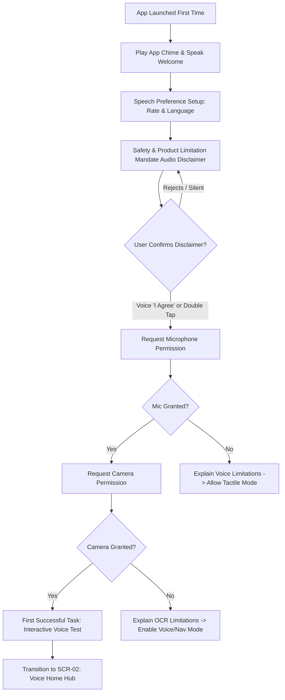
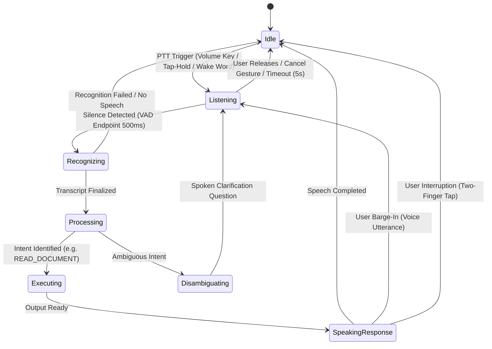
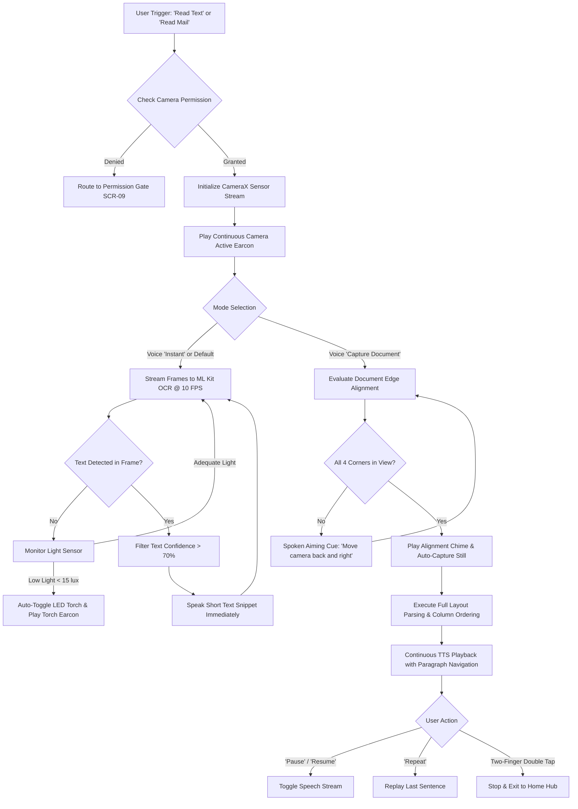
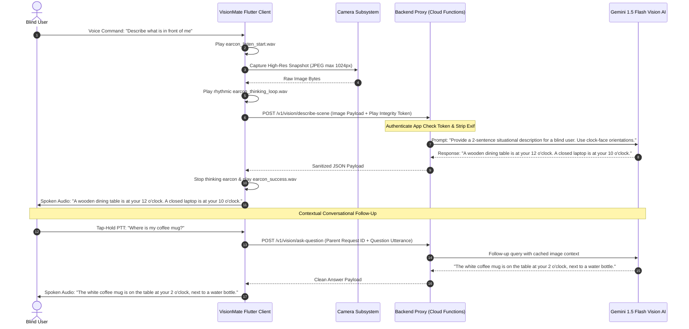
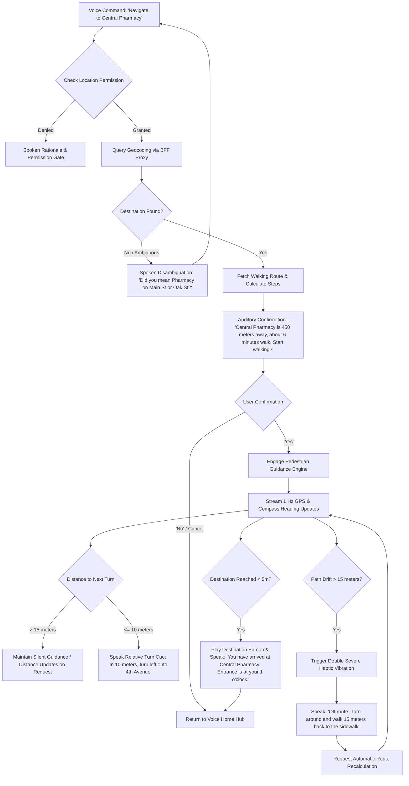
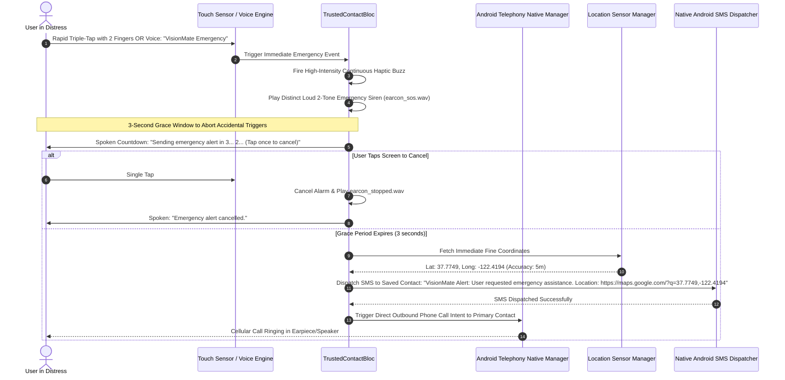
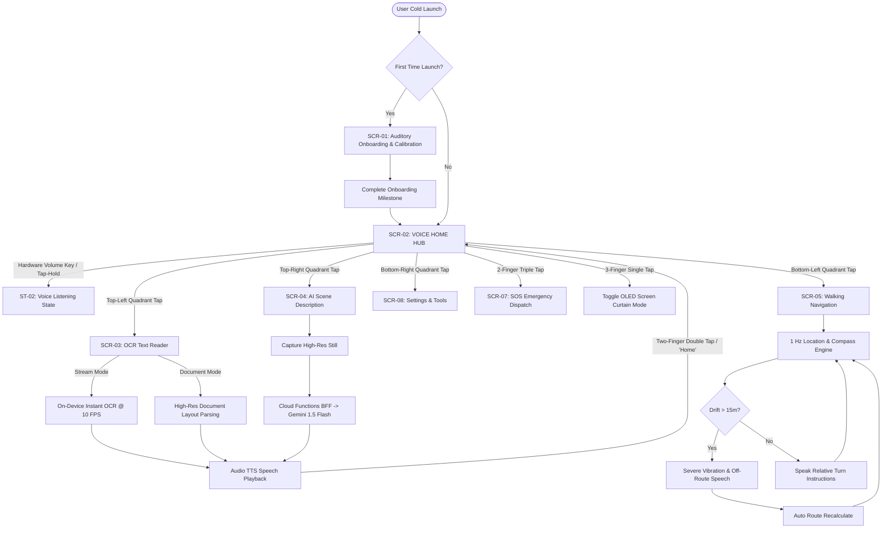

# VisionMate AI — Application Flow & Non-Visual Interaction Specification

**Document Version:** 1.0.0  
**Document Status:** Approved Interaction Architecture  
**Role Perspectives:** Senior UX Architect, Flutter Application Architect & Accessibility Specialist  
**Target Platform:** Android First (API 26+), Flutter 3.x, Designed for Non-Visual & Low-Vision Usability  
**Primary References:** [VisionMate AI PRD (v1.0.0)](file:///c:/Users/SACHIN%20VERMA/OneDrive/Desktop/Nayan/docs/01_PRD.md) & [VisionMate AI TRD (v1.0.0)](file:///c:/Users/SACHIN%20VERMA/OneDrive/Desktop/Nayan/docs/02_TRD.md)

---

## Table of Contents
1. [Application Navigation Structure & Global States](#1-application-navigation-structure--global-states)
2. [First-Time Onboarding Flow](#2-first-time-onboarding-flow)
3. [Voice Interaction & Conversational State Machine](#3-voice-interaction--conversational-state-machine)
4. [Camera-Based Optical Character Recognition (OCR) Flow](#4-camera-based-optical-character-recognition-ocr-flow)
5. [AI Multimodal Scene Understanding & Visual Q&A Flow](#5-ai-multimodal-scene-understanding--visual-qa-flow)
6. [Pedestrian Destination Search & Walking Navigation Flow](#6-pedestrian-destination-search--walking-navigation-flow)
7. [Ambient Information: News & Music Flows](#7-ambient-information-news--music-flows)
8. [Trusted Contacts & Emergency SOS Alerting Flow](#8-trusted-contacts--emergency-sos-alerting-flow)
9. [Permission-Denial & Re-Engagement Flows](#9-permission-denial--re-engagement-flows)
10. [Comprehensive Error & Recovery Flows](#10-comprehensive-error--recovery-flows)
11. [System Flowcharts & Architecture Interaction Diagrams](#11-system-flowcharts--architecture-interaction-diagrams)
12. [Complete Screen & Interaction State Inventory](#12-complete-screen--interaction-state-inventory)

---

## 1. Application Navigation Structure & Global States

VisionMate AI is structured around a **Hub-and-Spoke Voice-Centric Topology**. Unlike visual applications with deep nested menus, the interaction model prioritizes a persistent tactile and vocal home state where any sub-feature can be summoned instantly via voice command or a single macro-touch gesture.

```
+-------------------------------------------------------------------------------------------------------+
|                                  APPLICATION STATE & NAVIGATION TOPOLOGY                              |
+-------------------------------------------------------------------------------------------------------+
|                                                                                                       |
|                                       +-----------------------+                                       |
|                                       |   [FIRST_LAUNCH]      |                                       |
|                                       |   SCR-01: Onboarding  |                                       |
|                                       +-----------+-----------+                                       |
|                                                   | Onboarding Complete                               |
|                                                   v                                                   |
|                               +---------------------------------------+                               |
|   +-------------------------->|       SCR-02: VOICE HOME (HUB)        |<--------------------------+   |
|   |                           |  - Tap-Hold / Hardware Volume PTT     |                           |   |
|   |                           |  - High-Contrast Macro Buttons        |                           |   |
|   |                           |  - Triple-Tap Screen Curtain Toggle   |                           |   |
|   |                           +-------------------+-------------------+                           |   |
|   |                                               |                                               |   |
|   |               +---------------+---------------+---------------+---------------+               |   |
|   |               |               |               |               |               |               |   |
|   | Voice "Read"  | Voice "Scene" | Voice "Nav"   | Voice "News"  | Voice "Call"  | Voice "Prefs" |   |
|   | or Top-Left   | or Top-Right  | or Mid-Left   | or Mid-Right  | or SOS Chord  | or Bottom-Ctr |   |
|   |               |               |               |               |               |               |   |
|   v               v               v               v               v               v               |   |
| +-----------+   +-----------+   +-----------+   +-----------+   +-----------+   +-----------+     |   |
| |  SCR-03   |   |  SCR-04   |   |  SCR-05   |   |  SCR-06   |   |  SCR-07   |   |  SCR-08   |     |   |
| | OCR Reader|   | Scene AI  |   | WalkingNav|   | Media/News|   | SOS & Call|   | Settings  |     |   |
| | (On-Device|   | (Cloud Q&A|   | (Turn-by- |   | (RSS/Music|   | (Trusted  |   | (TTS Rate,|     |   |
| | Stream &  |   | Clock-Face|   | Turn &    |   | Intention)|   | Phone &   |   | Contrast, |     |   |
| | Document) |   | Snapshot) |   | Drift Hub)|   |           |   | SMS Alert)|   | Language) |     |   |
| +-----+-----+   +-----+-----+   +-----+-----+   +-----+-----+   +-----+-----+   +-----+-----+     |   |
|       |               |               |               |               |               |           |   |
|       +---------------+---------------+---------------+---------------+---------------+-----------+   |
|                         Return on "Home", "Stop", Two-Finger Double Tap, or Task Done                 |
+-------------------------------------------------------------------------------------------------------+
```

### Global Interaction Invariants
1. **The Universal Escape Gesture (Two-Finger Double Tap):** Tapping anywhere on the screen with two fingers immediately halts all active TTS speech, stops ongoing camera scanning, cancels active network queries, and returns the user to the `SCR-02: VOICE HOME` state.
2. **Push-to-Talk (PTT) Everywhere:** Double-pressing the physical hardware **Volume Down** key (or long-pressing the screen anywhere for 400 ms) engages the voice-command listener from *any* screen or modal state.
3. **No Hidden Focus Traps:** TalkBack swipe navigation moves predictably between a maximum of 4 high-contrast macro quadrants on any screen, preventing the user from becoming lost in deep widget trees.
4. **Default Screen State:** Continuous camera processing is **never** active by default upon launching the app. The camera sensor remains dormant until explicitly invoked by a user command.

---

## 2. First-Time Onboarding Flow

### 2.1 Design Objectives & Architectural Constraints
* **Zero Mandatory Account Creation:** Users can immediately read mail or test voice commands without entering emails, passwords, phone numbers, or completing CAPTCHAs.
* **Non-Visual Auditory Orientation:** The app starts speaking immediately upon initial cold launch, confirming that audio focus is acquired and guiding the user step-by-step.
* **Sequential Permission Grants with Spoken Rationales:** System permission dialogs are never triggered simultaneously; each is preceded by a clear, accessible spoken explanation.



### 2.2 Detailed Step-by-Step Sequence

#### Step 1: Welcome & Audio Handshake
* **System Event:** App initializes audio subsystem, acquires `AUDIOFOCUS_GAIN_TRANSIENT_MAY_DUCK`, and plays `earcon_welcome.wav`.
* **Spoken TTS Output:**  
  *"Welcome to VisionMate AI, your voice-first independence companion. At any time, hold one finger on the screen or double-press the Volume Down key to speak. Tap with two fingers to stop me talking. Let us configure your preferences."*

#### Step 2: Language and Speech Rate Calibration
* **Spoken TTS Output:**  
  *"My current speech rate is normal. Say 'Faster', 'Slower', or 'Keep' to confirm."*
* **User Input:** User speaks *"Faster"*.
* **System Reaction:** System increases TTS playback rate by 25% and speaks: *"Is this speed comfortable? Say 'Yes' or 'Slower'."*
* **Confirmation:** User says *"Yes"*. Setting is immediately persisted to `EncryptedSharedPreferences`.

#### Step 3: Mandatory Safety & Limitation Disclaimer
* **Spoken TTS Output:**  
  *"Important safety notice: VisionMate AI is an informational tool and does NOT replace your white cane, guide dog, or personal judgment. It cannot detect all drop-offs, fast-moving traffic, or overhead obstacles. To confirm you understand, say 'I understand' or double-tap the screen."*
* **Verification:** App blocks progression until explicit voice or tactile confirmation is received.

#### Step 4: Step-by-Step Accessible Permission Onboarding
1. **Microphone Permission:**  
   *Spoken Rationale:* *"To listen to your voice commands, VisionMate AI needs access to your microphone. An Android permission prompt will appear now."*  
   *Action:* Triggers `Permission.microphone.request()`.
2. **Camera Permission:**  
   *Spoken Rationale:* *"To read printed mail and describe your surroundings, VisionMate AI needs access to your camera. The permission prompt will appear now."*  
   *Action:* Triggers `Permission.camera.request()`.

#### Step 5: The "First Successful Task" Milestone
* **Spoken Prompt:**  
  *"Setup complete! Let us try your first command. Hold your finger on the screen and say 'What can you do?'"*
* **User Action:** User holds finger down and speaks the command.
* **System Output:** System chimes, transcribes, and speaks a concise 3-sentence summary of capabilities, then transitions seamlessly into `SCR-02: VOICE HOME`.

---

## 3. Voice Interaction & Conversational State Machine

The voice interaction lifecycle adheres to a deterministic, low-latency 7-state finite state machine with full **barge-in** interruption capabilities.



### 3.1 State Definitions and Acoustic Mapping

```
+-------------------------------------------------------------------------------------------------------+
| State ID       | Trigger Event          | Audio Earcon & Haptic Pulse | Spoken Output / System Action |
+----------------+------------------------+-----------------------------+-------------------------------+
| ST-01: IDLE    | App ready / task done  | None                        | Background listening disabled |
|                |                        |                             | (Zero battery overhead).      |
+----------------+------------------------+-----------------------------+-------------------------------+
| ST-02: LISTEN  | Double-click Vol Down  | earcon_listen_start.wav     | Mutes background media; audio |
|                | or Tap-Hold (400ms)    | Single 30ms sharp haptic    | buffer streams to STT engine. |
+----------------+------------------------+-----------------------------+-------------------------------+
| ST-03: RECOG   | Voice activity ends    | None (Preserves acoustic    | Generates final transcript    |
|                | (500ms silence)        | cleanliness for processing) | string from audio buffer.     |
+----------------+------------------------+-----------------------------+-------------------------------+
| ST-04: PROCESS | Valid transcript ready | earcon_processing.wav       | Dispatches text to Local NLU  |
|                |                        | (Subtle soft tone)          | Intent Classifier.            |
+----------------+------------------------+-----------------------------+-------------------------------+
| ST-05: EXECUTE | Intent recognized      | Feature-specific chime      | Launches OCR, Camera, Nav,    |
|                |                        |                             | or Phone module.              |
+----------------+------------------------+-----------------------------+-------------------------------+
| ST-06: SPEAK   | Results compiled       | earcon_success.wav          | Streams TTS speech; monitors  |
|                |                        | Soft haptic tick            | microphone for barge-in words.|
+----------------+------------------------+-----------------------------+-------------------------------+
| ST-07: CANCEL  | Two-finger tap /       | earcon_stopped.wav          | Halts active TTS; dumps       |
|                | "VisionMate Stop"      | Double blunt haptic pulse   | memory buffers; returns IDLE. |
+----------------+------------------------+-----------------------------+-------------------------------+
```

### 3.2 Spoken Barge-In Protocol
* While TTS is active in `ST-06: SPEAKING`, the native Android audio stream maintains an active low-gain Voice Activity Detector (VAD).
* If user vocal energy exceeds threshold (e.g., user says *"Stop"*, *"Repeat"*, or a new command *"Read faster"*):
  1. Internal TTS engine halts audio output within <= 100 milliseconds.
  2. The system evaluates whether the utterance was an interruption control command or a new intent.
  3. If a new intent is detected, it transitions directly to `ST-04: PROCESSING` without requiring a new PTT physical press.

---

## 4. Camera-Based Optical Character Recognition (OCR) Flow

VisionMate AI provides two distinct text-reading workflows: **Instant Stream Mode** (for quick scanning of signs, cans, and room numbers) and **Document Capture Mode** (for full-page mail, forms, and book chapters).



### 4.1 Audio-Guided Document Aiming Assistant
When in Document Mode, blind users receive directional spatial aiming instructions calculated from real-time bounding box edge geometry:
* *Camera Too Close:* If document text exceeds 90% of frame bounds:  
  *"Move camera back 6 inches."*
* *Document Cut Off on Right:* If right edge coordinates terminate abruptly:  
  *"Shift phone slightly to the right."*
* *Tilted / Perspective Skew > 20 degrees:*  
  *"Rotate phone clockwise to level the page."*
* *Perfect Alignment:* Emits a distinct harmonic ascending chime (`earcon_aligned.wav`), automatically engages image stabilization, and captures the high-resolution frame.

---

## 5. AI Multimodal Scene Understanding & Visual Q&A Flow



### 5.1 Safety & Uncertainty Handling Rules
* **Low Confidence Threshold (< 65%):** If the model confidence is low due to severe blur, glare, or darkness, the system will **refuse to guess**.  
  *Spoken Output:* *"The image is unclear due to strong glare. Please tilt the camera away from the light source and try again."*
* **Safety Refusal Trigger:** If the user asks safety-critical navigational questions (e.g., *"Is it safe to cross the street right now?"*), the backend injects an automated safety refusal:  
  *Spoken Output:* *"VisionMate AI cannot confirm if it is safe to cross. Please listen for traffic audio signals and rely on your cane or guide dog."*

---

## 6. Pedestrian Destination Search & Walking Navigation Flow



---

## 7. Ambient Information: News & Music Flows

### 7.1 Curated Audio News Flow
1. **Trigger:** User speaks *"Read today's news"* or *"Tech news"*.
2. **Retrieval:** Client dispatches query to BFF endpoint `/v1/news/headlines?category=tech`. Gateway parses top 3 articles from plaintext RSS (AP/NPR), stripping HTML tags.
3. **Spoken Output:**  
   *"Here are today's top stories. Story 1: [Headline]. Say 'Read story', 'Next story', or 'Stop'."*
4. **Playback Controls (Voice or Touch):**
   - Single tap on screen: Pause / Resume article reading.
   - Swipe right: Skip to next news story.
   - Voice command *"Summarize"*: Speaks a 3-bullet summary generated by the backend text parser.

### 7.2 Music Service Intent Integration
To comply with security and avoid unsupported custom streaming players, VisionMate AI controls external music through **Android Media Session Intents**:
1. **Trigger:** User speaks *"Play jazz on Spotify"* or *"Play the Beatles"*.
2. **Intent Dispatch:** The app constructs an Android `MediaStore.INTENT_ACTION_MEDIA_PLAY_FROM_SEARCH` intent with the parsed query.
3. **OS Handshake:** Android routes the intent to the user's default media player (Spotify, YouTube Music, or Samsung Music).
4. **Audio Focus Handling:** VisionMate AI releases `STREAM_MUSIC` audio focus, allowing the external music player to take precedence. The user can return to VisionMate at any time via the Volume Down PTT hardware chord.

---

## 8. Trusted Contacts & Emergency SOS Alerting Flow



---

## 9. Permission-Denial & Re-Engagement Flows

When critical operating system permissions are denied or revoked, VisionMate AI prevents dead-ends by guiding the user through spoken recovery instructions:

```
+-------------------------------------------------------------------------------------------------------+
| Permission Type | Consequence of Denial       | Immediate Spoken Voice Guidance                      |
+-----------------+-----------------------------+-------------------------------------------------------+
| Microphone      | Voice command recognition   | "Microphone permission is required to listen to your  |
| (RECORD_AUDIO)  | is fully disabled. Tactile  | voice commands. Say 'Open Settings' or double-tap the |
|                 | screen controls remain.     | screen to open system settings."                      |
+-----------------+-----------------------------+-------------------------------------------------------+
| Camera          | Instant OCR and AI Scene    | "Camera permission is disabled. Text reading and      |
| (CAMERA)        | Description are disabled.   | scene descriptions are unavailable. All voice and     |
|                 |                             | navigation features remain operational."              |
+-----------------+-----------------------------+-------------------------------------------------------+
| Fine Location   | Pedestrian turn-by-turn     | "Location access is turned off. Walking directions    |
| (ACCESS_FINE_   | guidance and SOS coordinate | cannot function. Text reading and phone assistance    |
|  LOCATION)      | dispatch are disabled.      | are still active."                                    |
+-----------------+-----------------------------+-------------------------------------------------------+
```

### The "Open Settings" Recovery Flow
1. User speaks *"Open Settings"* or double-taps the dedicated High-Contrast Recovery Button on `SCR-09: PERMISSION GATE`.
2. The app invokes `openAppSettings()` via platform channel, landing the user directly inside the OS application settings page for VisionMate AI.
3. Upon returning to the app, the `WidgetsBindingObserver.didChangeAppLifecycleState()` detects the resume event, re-evaluates permissions, and confirms via speech: *"Permissions updated. Returning to home."*

---

## 10. Comprehensive Error & Recovery Flows

```
+-------------------------------------------------------------------------------------------------------+
| Error Scenario      | Acoustic Earcon         | Spoken Guidance Message     | Automatic Recovery      |
+---------------------+-------------------------+-----------------------------+-------------------------+
| 1. No Speech        | Soft tick               | "I didn't hear anything.    | Resets listener; awaits |
|    Detected         | (earcon_warning.wav)    | Hold the screen to try      | next PTT trigger.       |
|                     |                         | speaking again."            |                         |
+---------------------+-------------------------+-----------------------------+-------------------------+
| 2. Speech Recog     | Soft double-buzz        | "I could not understand     | Suggests sample valid   |
|    Failure / Noise  | (earcon_warning.wav)    | that. Try saying 'Read      | phrases ("Read text",   |
|                     |                         | text' or 'Describe scene'." | "Navigate home").       |
+---------------------+-------------------------+-----------------------------+-------------------------+
| 3. No Text Found in | Subtle click            | "No text found in view.     | Keeps camera active;    |
|    OCR Frame        | (earcon_neutral.wav)    | Adjust distance or tilt     | prompts for better light|
|                     |                         | the document slightly."     | or alignment.           |
+---------------------+-------------------------+-----------------------------+-------------------------+
| 4. Severe Motion    | Quick descending chime  | "Image is too blurry. Hold  | Re-engages optical      |
|    Blur Detected    | (earcon_warning.wav)    | the phone steady for 2      | stabilization and waits |
|                     |                         | seconds to capture."        | for low accelerometer dV|
+---------------------+-------------------------+-----------------------------+-------------------------+
| 5. Cloud AI Vision  | Double low tone         | "Visual description server  | Automatically keeps     |
|    Unavailable      | (earcon_error.wav)      | is not responding. Text     | local on-device OCR     |
|                     |                         | reading is still available."| active and functional.  |
+---------------------+-------------------------+-----------------------------+-------------------------+
| 6. Slow / Offline   | Muffled tone            | "Internet connection lost.  | Retains 100% of offline |
|    Network          | (earcon_offline.wav)    | Offline text reading and    | features; retries cloud |
|                     |                         | contacts are active."       | with backoff.           |
+---------------------+-------------------------+-----------------------------+-------------------------+
| 7. GPS Inaccurate   | Double haptic pulse     | "GPS signal is weak between | Instructs user to halt; |
|    (Urban Canyon)   | (earcon_warning.wav)    | buildings. Rely on physical | disables distance steps |
|                     |                         | landmarks and your cane."   | until accuracy < 10m.   |
+---------------------+-------------------------+-----------------------------+-------------------------+
| 8. No Pedestrian    | Descending tone         | "No safe walking path found | Offers closest saved    |
|    Route Found      | (earcon_error.wav)      | to this location. Try a     | transit hub or address  |
|                     |                         | nearby cross street."       | re-search.              |
+---------------------+-------------------------+-----------------------------+-------------------------+
| 9. External App Not | Neutral chime           | "Spotify is not installed   | Prompts user to launch  |
|    Installed        | (earcon_neutral.wav)    | on this phone. Playing via  | default system player   |
|                     |                         | default audio player."      | instead.                |
+---------------------+-------------------------+-----------------------------+-------------------------+
| 10. System TTS      | Severe emergency haptic | [Visual High-Contrast Text] | Re-initializes Android  |
|     Engine Crashes  | pulse pattern           | "Audio engine restarted.    | TextToSpeech engine     |
|                     |                         | Tap to continue."           | instance in background. |
+-------------------------------------------------------------------------------------------------------+
```

---

## 11. System Flowcharts & Architecture Interaction Diagrams

### High-Level Unified System Flowchart



---

## 12. Complete Screen & Interaction State Inventory

```
+-------------------------------------------------------------------------------------------------------+
|                                    SCREEN & STATE INVENTORY                                           |
+-------------------------------------------------------------------------------------------------------+
```

### Screen 1: `SCR-01_ONBOARDING` (First-Launch Setup Wizard)
* **Purpose:** Introduce non-visual controls, calibrate TTS speech rate, secure explicit safety disclaimer agreement, and acquire necessary permissions.
* **Entry Condition:** First app launch, or user triggers *"Reset App"* from settings.
* **Available Actions:** Spoken responses (*"Faster"*, *"Slower"*, *"I understand"*), double-tap to confirm, two-finger tap to skip intro.
* **Expected Output:** Conversational spoken audio dialogue with accompanying high-contrast yellow-on-black visual typography (minimum font size 28sp).
* **Accessibility Requirements:** TalkBack focus automatically pinned to active prompt; all background animations suppressed; `Semantics` announcement triggered on every step change.
* **Exit Condition:** Safety disclaimer accepted and at least Microphone permission evaluated.
* **Error States:** Permission denied triggers spoken explanation and alternate non-vocal tactile guidance mode.

---

### Screen 2: `SCR-02_VOICE_HOME` (Main Hub & Interaction Anchor)
* **Purpose:** Central high-reliability anchor point for launching all assistive tools via voice command or 4 tactile macro quadrants.
* **Entry Condition:** Default state on app startup or post-onboarding completion.
* **Layout Structure:** Screen divided into 4 equal, tactile touch quadrants with high-contrast borders:
  - *Top-Left:* "Read Text" (Bright Yellow `#FFD700`, Black Text).
  - *Top-Right:* "Describe Scene" (Bright Cyan `#00FFFF`, Black Text).
  - *Bottom-Left:* "Walking Directions" (Bright Green `#39FF14`, Black Text).
  - *Bottom-Right:* "News & Settings" (White `#FFFFFF`, Black Text).
* **Available Actions:**
  1. Double-press hardware Volume Down key -> Triggers Push-to-Talk.
  2. Long-press screen anywhere (400ms) -> Triggers Push-to-Talk.
  3. Single-finger tap on any quadrant -> Speaks quadrant label and launches feature.
  4. Triple-tap screen with two fingers -> Engages Emergency SOS countdown.
  5. Triple-tap screen with three fingers -> Toggles Screen Curtain (OLED blackout).
* **Expected Output:** Emits soft `earcon_home.wav` on arrival; TalkBack announces: *"VisionMate Home. Hold anywhere to speak, or explore four feature quadrants."*
* **Accessibility Requirements:** Target touch zones minimum 150x150 dp; zero text below 24sp; contrast ratio 21:1 on OLED black.

---

### Screen 3: `SCR-03_OCR_READER` (Live Text & Document Scanner)
* **Purpose:** Perform real-time on-device text recognition on signs, packaging, and documents.
* **Entry Condition:** User says *"Read text"*, *"Read mail"*, or taps Top-Left Quadrant.
* **Available Actions:**
  1. Point camera -> Automatic real-time text speech.
  2. Voice command *"Capture document"* -> Triggers high-res layout capture.
  3. Single tap on screen -> Pause / Resume continuous reading.
  4. Swipe right -> Skip forward one paragraph.
  5. Swipe left -> Repeat previous sentence.
  6. Voice command *"Flashlight"* -> Toggles LED torch manually.
  7. Two-finger double tap -> Exits to `SCR-02_VOICE_HOME`.
* **Expected Output:** Real-time TTS playback of recognized text; subtle `earcon_text_detected.wav` click on detection.
* **Accessibility Requirements:** Live camera viewfinder excluded from TalkBack tree (`excludeSemantics: true`); text announcements dispatched via `SemanticsService.announce()`.
* **Error States:** Low-light triggers auto-torch; blurry image triggers spoken steadying cue.

---

### Screen 4: `SCR-04_SCENE_AI` (Visual Understanding & Contextual Q&A)
* **Purpose:** Capture situational snapshots and return 2-sentence spatial descriptions with clock-face landmarks.
* **Entry Condition:** User says *"Describe scene"*, *"What's around me"*, or taps Top-Right Quadrant.
* **Available Actions:**
  1. Automatic snapshot taken on entry.
  2. Hold screen to ask follow-up question (*"Where is the door?"*).
  3. Two-finger double tap -> Cancel / Return to Home.
* **Expected Output:** Rhythmic thinking earcon during cloud processing; spoken spatial description upon completion; high-contrast transcript displayed on screen.
* **Accessibility Requirements:** Screen curtain supported during cloud processing; audio focus retained throughout dialogue.
* **Error States:** Network timeout (>3.5s) emits warning earcon and triggers single retry; low confidence triggers refusal to guess.

---

### Screen 5: `SCR-05_WALKING_NAV` (Pedestrian Turn-by-Turn Guidance)
* **Purpose:** Guide blind pedestrians to outdoor destinations using relative directional cues and off-route vibration alerts.
* **Entry Condition:** User says *"Navigate to [destination]"* or taps Bottom-Left Quadrant.
* **Available Actions:**
  1. Voice search for destination.
  2. Voice confirmation (*"Start walking"* / *"Cancel"*).
  3. Shake phone -> Repeats current step and distance to next turn.
  4. Two-finger double tap -> Ends navigation session.
* **Expected Output:** Spoken relative directional instructions; double-pulse haptic buzz on off-route deviation (>15m); arrival fanfare earcon.
* **Accessibility Requirements:** Compass heading tied to device orientation; high-contrast direction arrow on screen for low-vision users.
* **Error States:** GPS accuracy > 20m triggers spoken warning to rely on physical cane.

---

### Screen 6: `SCR-06_NEWS_PLAYER` (Audio News & Media Utility)
* **Purpose:** Provide hands-free spoken news summaries from verified plaintext RSS feeds.
* **Entry Condition:** User says *"Read news"*, *"Technology news"*, or navigates from media quadrant.
* **Available Actions:**
  1. Single tap -> Pause / Resume playback.
  2. Swipe right -> Next headline.
  3. Voice command *"Summarize"* -> Speaks 3-bullet condensed summary.
  4. Two-finger double tap -> Return to Home.
* **Expected Output:** Natural TTS audio stream of clean news stories; audio player scrubber and large macro pause/play buttons on visual UI.
* **Accessibility Requirements:** Audio focus negotiated as `STREAM_MUSIC`; responds to Bluetooth headphone play/pause hardware buttons.

---

### Screen 7: `SCR-07_CONTACTS_SOS` (Emergency Alert & Phonebook Hub)
* **Purpose:** Manage trusted emergency contacts, initiate one-touch phone calls, and dispatch SOS alerts with live GPS coordinates.
* **Entry Condition:** User says *"Call [Name]"*, triggers two-finger triple-tap, or speaks *"VisionMate Emergency"*.
* **Available Actions:**
  1. Automatic 3-second countdown on SOS trigger with loud alternating siren.
  2. Single tap during countdown -> Aborts emergency call.
  3. Voice command *"Add contact"* -> Initiates contact setup wizard.
* **Expected Output:** Intense continuous haptic vibration; cellular phone dialer launch; automated SMS dispatch with Google Maps location link.
* **Accessibility Requirements:** Highest priority audio stream; overrides system silent/do-not-disturb profiles where permitted by Android OS.

---

### Screen 8: `SCR-08_SETTINGS` (Accessibility & System Customization)
* **Purpose:** Adjust speech synthesis rates, pitch, language, high-contrast visual themes, and haptic feedback intensity.
* **Entry Condition:** User says *"Settings"*, *"Preferences"*, or taps Bottom-Right Quadrant.
* **Available Actions:**
  1. Voice command *"Set speech rate to 2x"* -> Instantly updates TTS.
  2. Voice command *"Turn on Screen Curtain"* -> Blank OLED screen.
  3. Large accessible slider controls for speech rate (0.5x to 3.5x).
  4. Theme toggles: Pure Black & Yellow (Default), Cyan & Black, High-Contrast White.
* **Expected Output:** Immediate auditory preview of speech changes; tactile pulse on slider adjustments.
* **Accessibility Requirements:** Sliders feature distinct auditory ticks at every 0.1x increment; TalkBack announces exact percentage and numerical values.

---

### Screen 9: `SCR-09_PERMISSION_GATE` (Accessible Permission Recovery Modal)
* **Purpose:** Explain missing critical permissions in clear non-visual terms and provide a one-touch route to Android App Settings.
* **Entry Condition:** Invoked when user requests a feature requiring an ungranted permission.
* **Available Actions:**
  1. Voice command *"Open Settings"* or double-tap full screen -> Launches Android OS App Settings.
  2. Voice command *"Cancel"* or two-finger double-tap -> Returns to Home.
* **Expected Output:** Spoken rationale detailing exactly why the permission is needed; high-contrast warning icon and full-screen button.
* **Accessibility Requirements:** Focus locked exclusively to "Open Settings" and "Cancel" buttons; zero focus traps.

---

### Screen 10: `SCR-10_ERROR_RECOVERY` (Universal Non-Visual Error Screen)
* **Purpose:** Gracefully catch, announce, and recover from unexpected network timeouts, hardware disconnects, or system exceptions.
* **Entry Condition:** Unhandled exception or fatal network failure in any feature module.
* **Available Actions:**
  1. Double-tap screen -> Retries failed action.
  2. Voice command *"Go home"* or two-finger double tap -> Returns safely to `SCR-02_VOICE_HOME`.
* **Expected Output:** Distinct `earcon_warning.wav` sound; calm, plain-English spoken description of the error and available recovery choices.
* **Accessibility Requirements:** Automatic `SemanticsService.announce()` of the error message on entry; prevents user from feeling trapped in a frozen UI.

---
*End of Application Flow Document.*  
*Next Stage: Component Architecture Design, Wireframes, and Flutter Scaffold Implementation.*
