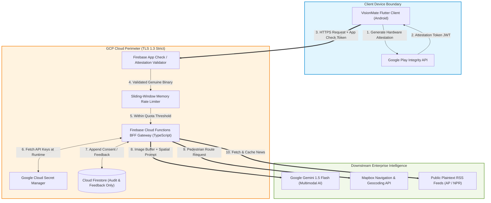
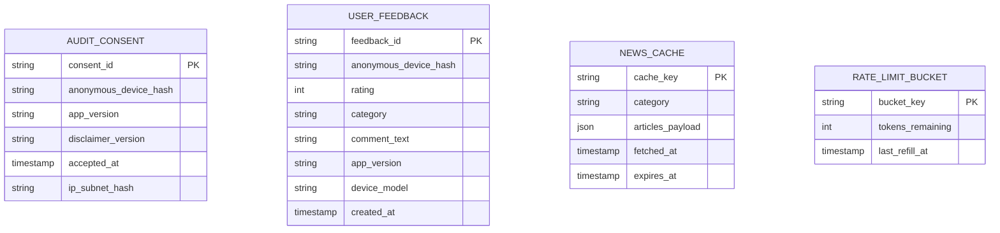
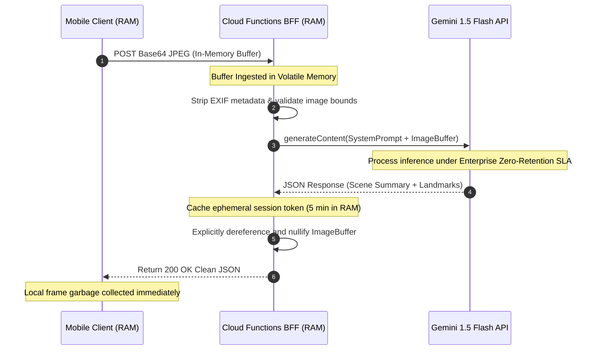

# VisionMate AI — Backend Architecture, API Contracts & Data Schema Specification

**Document Version:** 1.0.0  
**Document Status:** Approved Engineering Architecture & API Contract  
**Roles & Perspectives:** Senior Backend Architect, API Designer, Database Engineer & Application Security Specialist  
**Backend Framework:** Serverless Backend-For-Frontend (BFF) on Firebase Cloud Functions (Node.js 20 / TypeScript) & Cloud Firestore  
**Primary Baseline References:** [PRD (v1.0.0)](file:///c:/Users/SACHIN%20VERMA/OneDrive/Desktop/Nayan/docs/01_PRD.md), [TRD (v1.0.0)](file:///c:/Users/SACHIN%20VERMA/OneDrive/Desktop/Nayan/docs/02_TRD.md), [App Flow (v1.0.0)](file:///c:/Users/SACHIN%20VERMA/OneDrive/Desktop/Nayan/docs/03_APP_FLOW.md)

---

## Table of Contents
1. [Architectural Decision: On-Device vs. Backend Processing](#1-architectural-decision-on-device-vs-backend-processing)
2. [High-Level Backend Architecture & System Context](#2-high-level-backend-architecture--system-context)
3. [API Design & Endpoint Contracts](#3-api-design--endpoint-contracts)
4. [API Request & Response Payload Examples](#4-api-request--response-payload-examples)
5. [Database Schema & Entity Definitions](#5-database-schema--entity-definitions)
6. [Cloud Firestore Security Rules](#6-cloud-firestore-security-rules)
7. [AI Service Integration & Zero Data Retention Pipeline](#7-ai-service-integration--zero-data-retention-pipeline)
8. [Application Security, Rate Limiting & Abuse Prevention](#8-application-security-rate-limiting--abuse-prevention)
9. [Authorization Matrix](#9-authorization-matrix)
10. [Data Lifecycle & Retention Policy](#10-data-lifecycle--retention-policy)
11. [Environment Configuration (Secret Injection)](#11-environment-configuration-secret-injection)

---

## 1. Architectural Decision: On-Device vs. Backend Processing

A foundational requirement of VisionMate AI is **pragmatic minimalism**: we deliberately avoid constructing unnecessary backend microservices or centralized databases for features that can execute with greater privacy, zero cloud cost, and sub-second latency directly on the user's smartphone.

```
+-------------------------------------------------------------------------------------------------------+
|                                    PROCESSING ALLOCATION MATRIX                                       |
+--------------------+---------------------+------------------------------------------------------------+
| Feature Domain     | Execution Boundary  | Technical & Privacy Rationale                              |
+--------------------+---------------------+------------------------------------------------------------+
| Speech Recognition | 100% On-Device      | Android Native `SpeechRecognizer` API. Zero network        |
| (STT) & Synthesis  | (No Backend)        | latency; operates offline; voice audio never leaves device.|
+--------------------+---------------------+------------------------------------------------------------+
| Optical Character  | 100% On-Device      | Google ML Kit Text Recognition v2 running on mobile NPU.   |
| Recognition (OCR)  | (No Backend)        | Sub-second latency (<800ms); private mail/prescriptions    |
|                    |                     | never hit external servers; full offline capability.       |
+--------------------+---------------------+------------------------------------------------------------+
| User Preferences & | 100% On-Device      | Android Keystore + `EncryptedSharedPreferences`. Speech    |
| Accessibility Mode | (No Backend)        | rate, contrast, and curtain state stored locally.          |
+--------------------+---------------------+------------------------------------------------------------+
| Trusted Contacts & | 100% On-Device      | Android `TelephonyManager` & Native SMS. Contact numbers   |
| Emergency SOS      | (No Backend)        | stored locally in encrypted TEE; zero cloud contact leaks. |
+--------------------+---------------------+------------------------------------------------------------+
| AI Scene Snapshot  | Cloud BFF Proxy     | Gemini 1.5 Flash Multimodal LLM required for relational    |
| & Visual Q&A       | (Backend Required)  | spatial reasoning. Client keys strictly prohibited.        |
+--------------------+---------------------+------------------------------------------------------------+
| Pedestrian Walking | Cloud BFF Proxy     | Mapbox Directions & Geocoding. Proxied to hide commercial  |
| Navigation Routing | (Backend Required)  | tokens, enforce rate limits, and sanitize walking steps.   |
+--------------------+---------------------+------------------------------------------------------------+
| Ambient News Feed  | Cloud BFF Proxy     | Ingests raw public RSS XML (AP, NPR, BBC), strips HTML,    |
| & Summaries        | (Backend Required)  | caches sanitized JSON to protect client mobile bandwidth.  |
+--------------------+---------------------+------------------------------------------------------------+
| Anonymous Consent  | Cloud Firestore     | Legally mandated audit trail for safety disclaimer         |
| & Feedback Logging | (Backend Required)  | confirmation and voluntary accessibility feedback.         |
+--------------------+---------------------+------------------------------------------------------------+
```

---

## 2. High-Level Backend Architecture & System Context

The backend is implemented as a stateless, serverless **Backend-For-Frontend (BFF)** deployed on **Firebase Cloud Functions (2nd Gen)** powered by Google Cloud Run. It acts as an attested security gateway between the untrusted mobile client and downstream external AI/Mapping providers.



---

## 3. API Design & Endpoint Contracts

All endpoints are hosted under `https://api.visionmate.ai/v1` and communicate via JSON over HTTPS (TLS 1.3 enforced).

```
+-------------------------------------------------------------------------------------------------------+
|                                      API ENDPOINT SUMMARY TABLE                                       |
+--------+----------------------------+-----------------------+------------------+----------------------+
| Method | Endpoint Path              | Purpose               | Auth Level       | Target Latency (p95) |
+--------+----------------------------+-----------------------+------------------+----------------------+
| `POST` | `/v1/vision/describe`      | Snapshot Scene AI     | App Check Token  | <= 3.2 seconds       |
| `POST` | `/v1/vision/ask`           | Follow-up Visual Q&A  | App Check Token  | <= 2.8 seconds       |
| `GET`  | `/v1/navigation/route`     | Pedestrian Navigation | App Check Token  | <= 800 milliseconds  |
| `GET`  | `/v1/navigation/search`    | Geocoding Search      | App Check Token  | <= 600 milliseconds  |
| `GET`  | `/v1/news/headlines`       | Plaintext News Feed   | App Check Token  | <= 400 milliseconds  |
| `POST` | `/v1/audit/consent`        | Safety Audit Record   | App Check Token  | <= 350 milliseconds  |
| `POST` | `/v1/feedback`             | User A11y Feedback    | App Check Token  | <= 350 milliseconds  |
+--------+----------------------------+-----------------------+------------------+----------------------+
```

---

### 3.1 Endpoint: `POST /v1/vision/describe`

* **Purpose:** Processes a compressed camera still, strips all metadata in volatile memory, evaluates scene layout via Gemini 1.5 Flash, and returns a concise 2-sentence situational summary with relative clock-face landmarks.
* **Authentication:** Mandatory `X-Firebase-AppCheck` header containing a valid Play Integrity token.
* **Rate Limit:** 10 requests per minute per device ID; burst maximum of 2 requests within 5 seconds.
* **Timeout Behavior:** Hard serverless timeout at **4.0 seconds**. If Gemini does not respond, the gateway terminates upstream connection and returns `504 Gateway Timeout`.
* **Privacy Controls:** Image buffer is processed entirely in volatile RAM (Node.js `Buffer`) and destroyed immediately upon response completion. **Zero disk write, zero cloud database persistence.**

#### Request Schema (`application/json`)
```json
{
  "$schema": "http://json-schema.org/draft-07/schema#",
  "type": "object",
  "required": ["image_base64", "client_timestamp"],
  "properties": {
    "image_base64": {
      "type": "string",
      "description": "Base64-encoded JPEG image string. Max 1.5MB raw size, max 1024x1024 resolution."
    },
    "client_timestamp": {
      "type": "string",
      "format": "date-time",
      "description": "ISO-8601 UTC timestamp of client capture."
    },
    "preferred_language": {
      "type": "string",
      "enum": ["en", "es", "fr", "de", "hi"],
      "default": "en",
      "description": "Target language for spoken response."
    }
  },
  "additionalProperties": false
}
```

#### Response Schema (`application/json`)
```json
{
  "$schema": "http://json-schema.org/draft-07/schema#",
  "type": "object",
  "required": ["success", "data", "meta"],
  "properties": {
    "success": { "type": "boolean" },
    "data": {
      "type": "object",
      "required": ["session_id", "summary", "clock_face_cues", "confidence_level"],
      "properties": {
        "session_id": {
          "type": "string",
          "description": "Transient UUIDv4 valid for 5 minutes to support follow-up Q&A queries."
        },
        "summary": {
          "type": "string",
          "description": "Concise 2-sentence description tailored for speech synthesis."
        },
        "clock_face_cues": {
          "type": "array",
          "items": {
            "type": "object",
            "required": ["landmark", "clock_position", "estimated_distance_meters"],
            "properties": {
              "landmark": { "type": "string" },
              "clock_position": { "type": "string", "pattern": "^(1[0-2]|[1-9]) o'clock$" },
              "estimated_distance_meters": { "type": "number" }
            }
          }
        },
        "confidence_level": { "type": "string", "enum": ["HIGH", "MEDIUM", "LOW"] },
        "safety_advisory": { "type": "string", "nullable": true }
      }
    },
    "error": { "type": "null" },
    "meta": {
      "type": "object",
      "required": ["request_id", "latency_ms"],
      "properties": {
        "request_id": { "type": "string" },
        "latency_ms": { "type": "integer" }
      }
    }
  }
}
```

---

### 3.2 Endpoint: `POST /v1/vision/ask`

* **Purpose:** Allows conversational visual follow-up questions referencing a previously processed scene snapshot (e.g., *"Where is my white mug?"*).
* **Authentication:** Mandatory `X-Firebase-AppCheck`.
* **Rate Limit:** 15 requests per minute per device ID.
* **Timeout Behavior:** 3.5 seconds.
* **Validation Rules:** `session_id` must match a valid, unexpired server cache token (held in ephemeral Redis/Cloud Memory for max 300 seconds); `question` string length between 3 and 160 characters.

---

### 3.3 Endpoint: `GET /v1/navigation/route`

* **Purpose:** Proxies pedestrian routing queries to Mapbox Directions API, enforcing walking profiles, filtering vehicular highways, and formatting instructions into relative orientation steps.
* **Authentication:** Mandatory `X-Firebase-AppCheck`.
* **Query Parameters:**
  - `origin_lat` (Required, float, -90.0 to 90.0)
  - `origin_lng` (Required, float, -180.0 to 180.0)
  - `dest_lat` (Required, float, -90.0 to 90.0)
  - `dest_lng` (Required, float, -180.0 to 180.0)
* **Response:** Structured array of turn steps with distance, duration, relative maneuver (`TURN_LEFT`, `SLIGHT_RIGHT`), and spoken banner instructions.

---

### 3.4 Endpoint: `GET /v1/news/headlines`

* **Purpose:** Fetches, parses, and sanitizes top plaintext news articles from whitelisted open RSS feeds (AP, NPR, BBC). Strips all HTML styling, tracking pixels, and ads.
* **Caching Strategy:** Cloud Functions edge cache: `Cache-Control: public, max-age=900, s-maxage=1800` (15 minutes). Multiple client queries are served from memory cache with < 50ms latency.

---

### 3.5 Endpoint: `POST /v1/audit/consent`

* **Purpose:** Securely records explicit user acknowledgment of the Product Safety & Limitation Disclaimer (`SR-001`). Creates a non-repudiable compliance record.
* **Payload:** Anonymous Device Hash, App Version, Consent Timestamp, Acknowledged Disclaimer Version (`"v1.0-2026"`).

---

### 3.6 Endpoint: `POST /v1/feedback`

* **Purpose:** Collects accessibility bug reports, TalkBack glitches, and user suggestions.
* **Payload:** Rating (1-5), Category (`TALKBACK`, `OCR`, `VOICE`, `GENERAL`), User Feedback Text (max 500 chars), App Version, Device Model (e.g., `"Pixel 7"`). **Zero user PII collected.**

---

## 4. API Request & Response Payload Examples

### 4.1 Successful Scene Description (`POST /v1/vision/describe`)

#### Request Example:
```json
{
  "image_base64": "/9j/4AAQSkZJRgABAQEASABIAAD/2wBDAP...",
  "client_timestamp": "2026-10-25T07:35:10.450Z",
  "preferred_language": "en"
}
```

#### Response Example (200 OK):
```json
{
  "success": true,
  "data": {
    "session_id": "8f3b21a4-c5d9-4820-9281-ef0218f26a11",
    "summary": "You are facing an open hotel lobby with tiled flooring. A reception counter is straight ahead, and seating is on your right.",
    "clock_face_cues": [
      {
        "landmark": "Reception Check-in Desk",
        "clock_position": "12 o'clock",
        "estimated_distance_meters": 4.5
      },
      {
        "landmark": "Leather Armchairs",
        "clock_position": "2 o'clock",
        "estimated_distance_meters": 2.0
      },
      {
        "landmark": "Automatic Glass Sliding Doors",
        "clock_position": "6 o'clock",
        "estimated_distance_meters": 5.0
      }
    ],
    "confidence_level": "HIGH",
    "safety_advisory": null
  },
  "error": null,
  "meta": {
    "request_id": "req_01JAZ9B1K5N7Y92V6R7T8",
    "latency_ms": 1840
  }
}
```

---

### 4.2 Standardized Error Response Envelope

All API errors return a uniform, machine-readable, and user-safe JSON structure. Internal stack traces and database errors are **never** exposed to the client.

```json
{
  "success": false,
  "data": null,
  "error": {
    "code": "RATE_LIMIT_EXCEEDED",
    "message": "Too many visual queries. Please wait a few seconds before trying again.",
    "category": "RATE_LIMIT",
    "retry_after_seconds": 6,
    "details": {
      "limit": 10,
      "window_seconds": 60
    }
  },
  "meta": {
    "request_id": "req_01JAZ9E4M8B2X11N8V9T2",
    "timestamp": "2026-10-25T07:36:02.110Z"
  }
}
```

#### Complete Error Classification Taxonomy:
```
+--------------------------+------------+--------------------+-----------------------------------------------+
| Error Code               | HTTP State | Error Category     | Spoken Recovery Voice Output                 |
+--------------------------+------------+--------------------+-----------------------------------------------+
| `VALIDATION_IMAGE_SIZE`  | 400 Bad Req| VALIDATION         | "The captured image was too large to process."|
| `ATTESTATION_FAILED`     | 403 Forbid | AUTHENTICATION     | "Device security verification failed."        |
| `RATE_LIMIT_EXCEEDED`    | 429 TooMany| RATE_LIMIT         | "You are making requests too quickly. Please  |
|                          |            |                    | wait a few moments."                          |
| `AI_PROVIDER_TIMEOUT`    | 504 Timeout| PROVIDER_FAILURE   | "Visual description took too long to respond. |
|                          |            |                    | Retrying..."                                  |
| `AI_LOW_CONFIDENCE`      | 422 Unproc | PROVIDER_FAILURE   | "The image is too dark or blurry to describe."|
| `INTERNAL_SERVER_ERROR`  | 500 Server | UNEXPECTED_FAILURE | "An unexpected error occurred. Text reading   |
|                          |            |                    | is still working offline."                    |
+--------------------------+------------+--------------------+-----------------------------------------------+
```

---

## 5. Database Schema & Entity Definitions

To enforce strict data minimization, **Cloud Firestore** stores only audit trails, feedback, and backend caches. User preferences, trusted phone numbers, and location logs are **never** synced to the cloud.



### 5.1 Collection: `audit_consents`
* **Purpose:** Legal record verifying that the user accepted the safety disclaimer (`SR-001`) during onboarding.
* **Document ID:** Auto-generated Firestore UUIDv4 (`consent_id`).
* **Fields:**
  - `anonymous_device_hash` (String, Required): SHA-256 hash of device installation ID. Irreversible.
  - `app_version` (String, Required): e.g. `"1.0.0+104"`.
  - `disclaimer_version` (String, Required): e.g. `"v1.0-2026"`.
  - `accepted_at` (Timestamp, Required): UTC timestamp.
  - `ip_subnet_hash` (String, Required): Salted hash of `/24` IPv4 or `/48` IPv6 subnet (prevents exact IP logging).
* **Retention Policy:** Retained for 36 months to satisfy product liability compliance; auto-purged via Firestore TTL.

### 5.2 Collection: `user_feedback`
* **Purpose:** Collects accessibility bug reports and user ratings.
* **Document ID:** Auto-generated UUIDv4 (`feedback_id`).
* **Fields:**
  - `anonymous_device_hash` (String, Required): SHA-256 hash.
  - `rating` (Integer, Required): 1 to 5.
  - `category` (String, Required): Enum `["TALKBACK", "OCR", "VOICE", "NAV", "GENERAL"]`.
  - `comment_text` (String, Optional): User text up to 500 characters. Sanitized of script injection.
  - `app_version` (String, Required): e.g. `"1.0.0"`.
  - `device_model` (String, Optional): Sanitized model string (e.g. `"Pixel 7"`).
  - `created_at` (Timestamp, Required): Creation timestamp.
* **Retention Policy:** Retained for 90 days; auto-purged via Firestore TTL.

### 5.3 Collection: `news_cache`
* **Purpose:** Ephemeral storage for parsed RSS headlines to minimize upstream requests.
* **Document ID:** e.g. `"headlines_tech_en"`.
* **Fields:**
  - `category` (String, Required): `"world"`, `"tech"`, `"science"`.
  - `articles_payload` (Map/JSON, Required): Array of parsed title, summary, source, pubDate.
  - `fetched_at` (Timestamp, Required): Ingestion timestamp.
  - `expires_at` (Timestamp, Required): Managed via Firestore TTL policy (15 minutes).

---

## 6. Cloud Firestore Security Rules

The database security configuration follows the **Principle of Least Privilege**. Direct mobile client read/write access to all collections is **completely blocked**. All database interactions occur strictly through authenticated Cloud Functions server code using the Admin SDK.

```javascript
rules_version = '2';
service cloud.firestore {
  match /databases/{database}/documents {
    
    // Deny all direct client read and write access by default
    match /{document=**} {
      allow read, write: if false;
    }

    // Explicit Rules for Audit Consents
    // Mobile clients cannot query or modify consent records directly.
    // Writes are mediated exclusively by the trusted Cloud Function backend.
    match /audit_consents/{consentId} {
      allow read, write: if false;
    }

    // Explicit Rules for User Feedback
    // Client cannot read other users' feedback; writes are mediated via BFF.
    match /user_feedback/{feedbackId} {
      allow read, write: if false;
    }

    // News Cache is strictly internal to Cloud Functions
    match /news_cache/{cacheKey} {
      allow read, write: if false;
    }
  }
}
```

---

## 7. AI Service Integration & Zero Data Retention Pipeline

The backend interacts with **Google Gemini 1.5 Flash** using the official `@google/genai` SDK. To protect blind and low-vision users' privacy, the architecture enforces an uncompromising **Zero Data Retention (ZDR)** processing contract.



### 7.1 Specialized Assistive System Prompt
To ensure Gemini outputs safe, non-hallucinatory, spatially grounded responses, the backend wraps every visual snapshot with this strict system instruction:

```text
You are VisionMate AI, a vision assistant for a blind or low-vision user.
Describe the user's immediate environment concisely in exactly 2 clear sentences.
Prioritize:
1. Ground surface changes, steps, doors, or major obstacles directly in the path.
2. Prominent objects and landmarks described strictly using relative clock-face positions (e.g. 'Door at your 12 o'clock, chair at your 2 o'clock').
3. Estimated distances in meters.

CRITICAL SAFETY RULES:
- Never declare a path 'safe to walk' or an intersection 'safe to cross'.
- If the image is blurry, overexposed, or too dark to determine objects with certainty, respond with: 'UNAVAILABLE: Image is too dark or blurry to identify surroundings reliably.'
- Do not mention photographic technical terms like 'in this image', 'the photo shows', or 'in the frame'. Speak directly to the user.
```

---

## 8. Application Security, Rate Limiting & Abuse Prevention

### 8.1 Device Attestation via Firebase App Check
Every incoming request to `/v1/*` must present a valid, signed JWT in the `X-Firebase-AppCheck` header.
* The backend verifies the token using the Google Public Certificates.
* Tokens are issued only to genuine, unmodified Android binaries validated via the **Google Play Integrity API**.
* Requests with missing, expired, or invalid tokens are immediately rejected with an **HTTP 403 Forbidden** before any downstream cloud service is invoked.

### 8.2 Sliding-Window Token-Bucket Rate Limiter
To prevent bot abuse, denial-of-wallet attacks, and runaway client loops, a multi-tiered rate limiter is enforced at the Gateway:
* **Vision Describe Endpoint:** Max 10 requests / minute per client hash; burst limit: 2 requests / 5 seconds.
* **Vision Ask Endpoint:** Max 15 requests / minute per client hash.
* **Navigation Proxy:** Max 30 requests / minute per client hash.
* **News Proxy:** Max 60 requests / minute per client hash.

### 8.3 In-Flight Payload Sanitization & Size Caps
* The Gateway rejects any HTTP request payload exceeding **2.0 MB** with an immediate `413 Payload Too Large`.
* Base64 image payloads are decoded directly into native byte arrays; file magic numbers are inspected to ensure valid JPEG (`0xFFD8FF`) or PNG (`0x89504E47`) headers. Any other MIME type is rejected.

---

## 9. Authorization Matrix

```
+------------------------------------+------------------+-----------------------+-----------------------+
| Resource / Operation               | Public (No Auth) | App Check Attested    | Admin / Internal      |
+------------------------------------+------------------+-----------------------+-----------------------+
| View Static Legal / Privacy Policy | ALLOW            | ALLOW                 | ALLOW                 |
| Invoke `/v1/vision/describe`       | DENY (403)       | ALLOW (Rate Limited)  | ALLOW                 |
| Invoke `/v1/vision/ask`            | DENY (403)       | ALLOW (Rate Limited)  | ALLOW                 |
| Invoke `/v1/navigation/route`      | DENY (403)       | ALLOW (Rate Limited)  | ALLOW                 |
| Submit `/v1/audit/consent`         | DENY (403)       | ALLOW                 | ALLOW                 |
| Submit `/v1/feedback`              | DENY (403)       | ALLOW                 | ALLOW                 |
| Direct Firestore Client Reads      | DENY (Rule)      | DENY (Rule)           | ALLOW (Admin SDK Only)|
| Access Secret Manager API Keys     | DENY             | DENY                  | ALLOW (BFF Service Ac)|
+------------------------------------+------------------+-----------------------+-----------------------+
```

---

## 10. Data Lifecycle & Retention Policy

```
+------------------------------------------------------------------------------------------------------+
| Data Artifact        | Storage Medium        | Encryption Standard   | Purge Mechanism & Schedule    |
+----------------------+-----------------------+-----------------------+-------------------------------+
| User Video Frames    | Volatile Mobile RAM   | In-Memory Only        | Overwritten on next frame     |
| (Instant OCR)        | (Never Sent to Cloud) | (Non-Persistent)      | (0 ms persistence)            |
+----------------------+-----------------------+-----------------------+-------------------------------+
| Scene Still Snapshot | Volatile Gateway RAM  | TLS 1.3 In-Transit    | Zero Cloud Storage. Memory    |
| (Cloud AI Query)     | (Node.js Buffer)      | Buffer                | buffer dereferenced post-call.|
+----------------------+-----------------------+-----------------------+-------------------------------+
| User Voice Audio     | Volatile Mobile Audio | In-Memory Audio Record| Flushed immediately after     |
| (STT Commands)       | Buffer                | Buffer                | speech endpoint detection.    |
+----------------------+-----------------------+-----------------------+-------------------------------+
| Trusted Contacts     | Mobile Device Only    | AES-256 GCM (Android  | Retained locally until user   |
| (Names & Phones)     | (EncryptedSharedPrefs)| Keystore Hardware TEE)| deletes app data. Zero Cloud. |
+----------------------+-----------------------+-----------------------+-------------------------------+
| Audit Consent Record | Cloud Firestore       | AES-256 at Rest       | Auto-purged after 36 months   |
|                      |                       | (Google Managed Keys) | via Firestore TTL Policy.     |
+----------------------+-----------------------+-----------------------+-------------------------------+
| User Feedback        | Cloud Firestore       | AES-256 at Rest       | Auto-purged after 90 days     |
| Submissions          |                       | (Google Managed Keys) | via Firestore TTL Policy.     |
+------------------------------------------------------------------------------------------------------+
```

---

## 11. Environment Configuration (Secret Injection)

All external API tokens are stored in **Google Cloud Secret Manager** and injected into the Cloud Functions execution environment at runtime. **No secret is ever checked into Git or stored in client configuration files.**

### Production Environment Variable Mapping:
```bash
# ==============================================================================
# VISIONMATE AI - CLOUD FUNCTIONS ENVIRONMENT VARIABLE SPECIFICATION
# All sensitive variables are bound to Google Cloud Secret Manager resource IDs
# ==============================================================================

# Server Runtime Configuration
NODE_ENV="production"
PORT=8080
API_VERSION="v1"
CORS_ORIGIN="https://visionmate.ai"

# Google Gemini Multimodal AI Integration
# Secret Name in GCP Secret Manager: projects/visionmate-prod/secrets/GEMINI_API_KEY
GEMINI_API_KEY="projects/visionmate-prod/secrets/GEMINI_API_KEY/versions/latest"
GEMINI_MODEL_NAME="gemini-1.5-flash-001"
GEMINI_TIMEOUT_MS=3500

# Mapbox Navigation & Geocoding Integration
# Secret Name in GCP Secret Manager: projects/visionmate-prod/secrets/MAPBOX_SECRET_TOKEN
MAPBOX_ACCESS_TOKEN="projects/visionmate-prod/secrets/MAPBOX_SECRET_TOKEN/versions/latest"
MAPBOX_TIMEOUT_MS=2000

# Firebase App Check & Play Integrity Validation
APP_CHECK_PROJECT_NUMBER="984210984123"
APP_CHECK_ENFORCEMENT_MODE="STRICT"

# Rate Limiting Parameters
RATE_LIMIT_VISION_PER_MIN=10
RATE_LIMIT_NAV_PER_MIN=30
RATE_LIMIT_BURST_MAX=2
```

---
*End of Backend Architecture, API Contracts & Data Schema Specification.*  
*Next Stage: Flutter Mobile Implementation, BFF Serverless Function Deployment, and End-to-End Integration Testing.*
