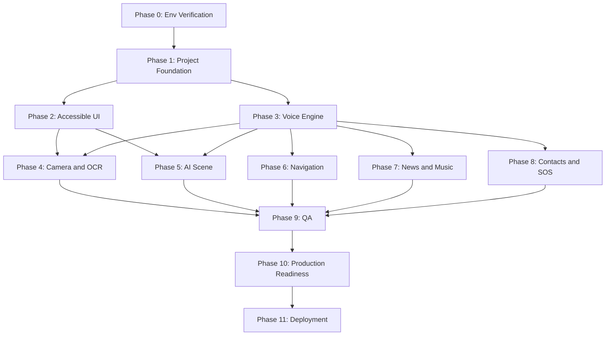

# VisionMate AI — Complete Implementation Plan
## From Blank Repository to Android Deployment

**Document Version:** 1.0.0
**Document Status:** Active Engineering Roadmap
**Prepared by:** Senior Technical Lead, Flutter Developer, Backend Engineer, QA Engineer & Release Manager
**Environment Inspection Date:** 2026-10-25
**Primary References:** docs/01_PRD.md | docs/02_TRD.md | docs/03_APP_FLOW.md | docs/04_UI_UX_BRIEF.md | docs/05_BACKEND_SCHEMA.md

---

## Actual Environment State (Inspected)

| Component | Inspected State | Action Required |
|---|---|---|
| Flutter SDK | 3.47.8 stable | None — ready |
| Dart SDK | 3.13.7 | None — ready |
| Android SDK | 37.0.0 PATH HAS SPACES | Workaround documented in Phase 0 |
| Android Emulator | Medium Phone API 37.0 | None — ready to launch |
| Git | 2.55.0 installed, no repo yet | git init in Phase 0 |
| Flutter Project | NOT CREATED | Phase 1 creates it |
| Visual Studio | Not installed (irrelevant for Android) | No action needed |
| Docs | 5 planning docs created | Foundation for this plan |

> NOTE: The Android SDK lives at `C:\Users\SACHIN VERMA\AppData\Local\Android\sdk`. The space in
> SACHIN VERMA causes issues only with the NDK (native C++ builds). VisionMate AI does not use the
> NDK for MVP, so this warning is non-blocking. Handled in Phase 0.

---

## Table of Contents

1. Milestone Roadmap and Timeline
2. Dependency Graph
3. Feature Implementation Matrix
4. Testing Matrix
5. Phase 0: Environment Verification and Fix
6. Phase 1: Project Foundation
7. Phase 2: Accessible UI Foundation
8. Phase 3: Voice Interaction Engine
9. Phase 4: Camera and OCR
10. Phase 5: AI Scene Understanding
11. Phase 6: Pedestrian Navigation
12. Phase 7: News and Music
13. Phase 8: Trusted Contacts and SOS
14. Phase 9: Quality Assurance
15. Phase 10: Production Readiness
16. Phase 11: Deployment
17. Deployment Checklist
18. Unresolved Technical Decisions
19. Definition of Done — MVP

---

## Milestone Roadmap and Timeline

Estimates assume one focused developer using Antigravity AI assistance.

| Phase | Name | Estimated Effort | Must-Complete Before |
|---|---|---|---|
| P-0 | Environment Verification | 0.5 day | All other phases |
| P-1 | Project Foundation | 1-2 days | P-2 through P-11 |
| P-2 | Accessible UI Foundation | 3-4 days | P-3, P-4, P-5 |
| P-3 | Voice Interaction Engine | 3-4 days | P-4, P-5, P-6, P-7, P-8 |
| P-4 | Camera and OCR | 2-3 days | P-9 |
| P-5 | AI Scene Understanding | 3-4 days | P-9 |
| P-6 | Pedestrian Navigation | 3-5 days | P-9 (needs real device) |
| P-7 | News and Music | 2-3 days | P-9 |
| P-8 | Trusted Contacts and SOS | 2-3 days | P-9 (legal review) |
| P-9 | Quality Assurance | 4-6 days | P-10 |
| P-10 | Production Readiness | 2-3 days | P-11 |
| P-11 | Deployment | 1-2 days | None |
| TOTAL | MVP End-to-End | ~27-39 developer days | Sequential, some parallel |

---

## Dependency Graph



---

## Feature Implementation Matrix

| Feature | Phase | On-Device | Backend | MVP | Post-MVP |
|---|---|---|---|---|---|
| Accessible Onboarding Wizard | P-2 | Yes | No | Yes | |
| Push-to-Talk Voice Commands | P-3 | Yes | No | Yes | |
| Text-to-Speech Output | P-3 | Yes | No | Yes | |
| Voice Barge-In Interruption | P-3 | Yes | No | Yes | |
| Instant OCR Streaming | P-4 | Yes | No | Yes | |
| Document Capture and Read | P-4 | Yes | No | Yes | |
| AI Scene Description | P-5 | No | Yes | Yes | |
| Visual Follow-up Q and A | P-5 | No | Yes | No | Yes |
| Destination Voice Search | P-6 | No | Yes | No | Yes |
| Pedestrian Turn-by-Turn Nav | P-6 | GPS | Yes | No | Yes |
| News Headlines Audio Reader | P-7 | No | Yes | No | Yes |
| Music Intent Integration | P-7 | Yes | No | No | Yes |
| Emergency SOS and SMS | P-8 | Yes | No | Yes | |
| Voice Contact Dialing | P-8 | Yes | No | Yes | |
| Screen Curtain OLED Black | P-2 | Yes | No | Yes | |
| High-Contrast Theme | P-2 | Yes | No | Yes | |
| TalkBack Semantics | P-2 | Yes | No | Yes | |
| Speech Rate Configuration | P-2 | Yes | No | Yes | |
| Haptic Feedback Engine | P-2 | Yes | No | Yes | |

---

## Testing Matrix

| Feature | Unit | Widget | Integration | TalkBack | Real Device |
|---|---|---|---|---|---|
| Voice Command Intent Parser | Yes | No | Yes | No | Yes |
| TTS Speech Engine | Yes | No | Yes | Yes | Yes |
| ML Kit OCR Engine | Yes | No | Yes | No | Required |
| AI Scene Description BLoC | Yes | No | Yes | Yes | Yes |
| Navigation BLoC GPS | Yes | No | No | Yes | Required |
| SOS Emergency Dispatch | Yes | No | Yes | Yes | Required |
| Accessible UI Semantics | No | Yes | No | Yes | Yes |
| Onboarding Flow | Yes | Yes | Yes | Yes | Yes |
| Settings Persistence | Yes | Yes | No | No | No |
| Offline Fallback Behavior | Yes | No | Yes | No | Yes |
| Error Recovery States | Yes | Yes | Yes | Yes | No |

---

## Phase 0: Environment Verification and Fix

### Objective
Confirm toolchain works, resolve Android SDK path-spaces warning, verify emulator boots, initialize Git.

### Task 0.1 — Set ANDROID_HOME

```powershell
[System.Environment]::SetEnvironmentVariable("ANDROID_HOME","C:\Users\SACHIN VERMA\AppData\Local\Android\sdk","User")
$env:ANDROID_HOME = "C:\Users\SACHIN VERMA\AppData\Local\Android\sdk"
Write-Host "ANDROID_HOME = $env:ANDROID_HOME"
```

### Task 0.2 — Accept Android SDK Licenses

```powershell
& "$env:ANDROID_HOME\cmdline-tools\latest\bin\sdkmanager.bat" --licenses
```
Answer `y` to each prompt.

### Task 0.3 — Boot Emulator and Verify

```powershell
flutter emulators --launch Medium_Phone_API_37.0
# Wait 30 seconds, then:
flutter devices
```
Expected: Android SDK built for x86_64 appears in device list.

### Task 0.4 — Initialize Git

```powershell
git init
git config user.name "Your Name"
git config user.email "your.email@example.com"
```

### Task 0.5 — Create .gitignore

Create a file called `.gitignore` in the project root containing:

```
# Flutter
.dart_tool/
.flutter-plugins
.flutter-plugins-dependencies
build/
.pub-cache/
.pub/
*.iml

# Android signing — NEVER COMMIT
*.jks
*.keystore
key.properties
**/android/key.properties

# Secrets
.env
.env.*
**/google-services.json
**/GoogleService-Info.plist

# IDE
.idea/
*.swp
.vscode/

# OS
.DS_Store
Thumbs.db
```

### Task 0.6 — First Commit

```powershell
git add docs/ .gitignore
git commit -m "chore: initialize repository with planning documents"
```

### Acceptance Criteria
- flutter doctor shows Android SDK found (spaces warning acceptable)
- flutter emulators --launch boots the emulator successfully
- flutter devices lists the emulator
- git log --oneline shows the first commit
- .gitignore present and blocks *.jks and .env files

### Common Errors and Solutions

| Error | Cause | Solution |
|---|---|---|
| sdkmanager not found | cmdline-tools not installed | Android Studio > SDK Manager > Command-line Tools |
| Emulator fails to boot | Hypervisor disabled | Enable Intel HAXM in BIOS or install Android Emulator Hypervisor Driver |
| Git identity required | User not configured | git config --global user.name and user.email |

### Antigravity Prompts
- "Check my flutter doctor output and list every action I need to take before starting a Flutter project"
- "Write a PowerShell script that sets ANDROID_HOME permanently for the current Windows user"

---

## Phase 1: Project Foundation

### Objective
Create Flutter Android project, establish Clean Architecture structure, configure design-system theme, set up navigation, install all MVP dependencies, produce first runnable build.

### Prerequisites
- Phase 0 complete

### Required Packages

```yaml
dependencies:
  flutter:
    sdk: flutter
  flutter_bloc: ^9.1.1
  equatable: ^2.0.9
  flutter_tts: ^4.2.2
  speech_to_text: ^7.0.0
  audioplayers: ^6.4.0
  camera: ^0.11.1
  google_mlkit_text_recognition: ^0.14.0
  geolocator: ^14.0.0
  flutter_compass: ^0.8.0
  permission_handler: ^12.0.1
  dio: ^5.9.0
  connectivity_plus: ^6.1.4
  flutter_secure_storage: ^9.2.4
  shared_preferences: ^2.5.3
  vibration: ^3.1.3
  url_launcher: ^6.3.1
  firebase_core: ^3.13.1
  firebase_app_check: ^0.3.3+1
  firebase_crashlytics: ^4.3.5
  uuid: ^4.5.1
  intl: ^0.20.2

dev_dependencies:
  flutter_test:
    sdk: flutter
  bloc_test: ^10.0.0
  mocktail: ^1.0.4
  flutter_lints: ^5.0.0
```

### Task 1.1 — Create Flutter Project

```powershell
flutter create --org com.visionmate --project-name visionmate_ai --description "Voice-first assistive application for blind and low-vision users" --platforms android --template app .
```

Note: flutter create . creates inside the current directory, cleanly merging with the existing docs/ folder.

### Task 1.2 — Install Dependencies

```powershell
flutter pub get
```

### Task 1.3 — Create Clean Architecture Folder Structure

```powershell
$dirs = @(
  "lib/app","lib/app/theme",
  "lib/core/audio","lib/core/error","lib/core/network","lib/core/security","lib/core/permissions",
  "lib/features/onboarding/data","lib/features/onboarding/domain",
  "lib/features/onboarding/presentation/bloc","lib/features/onboarding/presentation/screens",
  "lib/features/home/presentation/screens",
  "lib/features/voice_command/data","lib/features/voice_command/domain",
  "lib/features/voice_command/presentation/bloc",
  "lib/features/ocr_reader/data/datasources","lib/features/ocr_reader/domain",
  "lib/features/ocr_reader/presentation/bloc","lib/features/ocr_reader/presentation/screens",
  "lib/features/scene_description/data/datasources","lib/features/scene_description/domain",
  "lib/features/scene_description/presentation/bloc","lib/features/scene_description/presentation/screens",
  "lib/features/walking_nav/data","lib/features/walking_nav/domain",
  "lib/features/walking_nav/presentation/bloc","lib/features/walking_nav/presentation/screens",
  "lib/features/trusted_contacts/data","lib/features/trusted_contacts/domain",
  "lib/features/trusted_contacts/presentation/bloc","lib/features/trusted_contacts/presentation/screens",
  "lib/features/news/data","lib/features/news/presentation/bloc","lib/features/news/presentation/screens",
  "lib/features/settings/data","lib/features/settings/presentation/bloc",
  "lib/features/settings/presentation/screens",
  "lib/platform",
  "assets/audio","assets/icons",
  "test/core","test/features/voice_command","test/features/ocr_reader","test/features/scene_description"
)
foreach ($dir in $dirs) {
  New-Item -ItemType Directory -Path $dir -Force | Out-Null
  New-Item -ItemType File -Path "$dir/.gitkeep" -Force | Out-Null
}
Write-Host "Folder structure created"
```

### Task 1.4 — Configure AndroidManifest.xml

Add before the `<application>` tag in `android/app/src/main/AndroidManifest.xml`:

```xml
<uses-permission android:name="android.permission.RECORD_AUDIO" />
<uses-permission android:name="android.permission.CAMERA" />
<uses-permission android:name="android.permission.FLASHLIGHT" />
<uses-permission android:name="android.permission.ACCESS_FINE_LOCATION" />
<uses-permission android:name="android.permission.ACCESS_COARSE_LOCATION" />
<uses-permission android:name="android.permission.CALL_PHONE" />
<uses-permission android:name="android.permission.SEND_SMS" />
<uses-permission android:name="android.permission.READ_CONTACTS" />
<uses-permission android:name="android.permission.INTERNET" />
<uses-permission android:name="android.permission.ACCESS_NETWORK_STATE" />
<uses-permission android:name="android.permission.VIBRATE" />
<uses-feature android:name="android.hardware.camera" android:required="true" />
<uses-feature android:name="android.hardware.camera.autofocus" />
```

Update application tag to add `android:label="VisionMate AI"` and `android:enableOnBackInvokedCallback="true"`.

### Task 1.5 — Create Design System Theme
Create `lib/app/theme/app_colors.dart`, `app_typography.dart`, and `app_theme.dart`.
Colors: pure black canvas, #FFD700 primary, #00E5FF secondary. All contrasts >= 7:1 WCAG AAA.
Typography: Inter/Roboto from Google Fonts, scalable from 14sp to 28sp body text.

### Task 1.6 — Create App Router
`lib/app/routes.dart` with named routes for all 11 screens: onboarding, home, voiceOverlay, ocrReader,
sceneDescription, destinationSearch, navigation, newsPlayer, musicController, trustedContacts, settings.

### Task 1.7 — Create main.dart
Wire MultiBlocProvider, MaterialApp with theme, and initial route to onboarding or home.

### Task 1.8 — Verify First Run

```powershell
flutter run -d Medium_Phone_API_37.0 --debug
```
Expected: App launches on emulator without crash.

### Files Created
- pubspec.yaml (updated)
- lib/app/app.dart
- lib/app/routes.dart
- lib/app/theme/app_colors.dart
- lib/app/theme/app_typography.dart
- lib/app/theme/app_theme.dart
- android/app/src/main/AndroidManifest.xml (updated)
- Full lib/ Clean Architecture scaffold

### Git Checkpoint

```powershell
git add .
git commit -m "feat(foundation): create Flutter project, folder structure, theme, and navigation scaffold"
```

### Acceptance Criteria
- flutter pub get exits with 0 errors
- flutter run launches on emulator without crash
- flutter analyze reports zero errors (warnings acceptable)
- All 11 screen route names declared in routes.dart
- lib/ folder matches Clean Architecture structure

### Antigravity Prompts
- "Create a Flutter ThemeData with pure black canvas, #FFD700 primary, #00E5FF secondary, WCAG AAA contrast for all text, Inter/Roboto font"
- "Create named routes for VisionMate AI's 11 screens following the App Flow document"

---

## Phase 2: Accessible UI Foundation

### Objective
Build all 11 screen shells with Semantics() wrappers, TalkBack focus order, high-contrast styling, Screen Curtain, haptic engine, and earcon sound engine.

### Prerequisites
- Phase 1 complete

### Task 2.1 — Earcon Sound Engine
`lib/core/audio/earcon_player.dart` using audioplayers. Pre-cache all WAV clips on app start.

### Task 2.2 — Add Earcon Audio Assets
Place in `assets/audio/`:
- earcon_listen_start.wav
- earcon_success.wav
- earcon_warning.wav
- earcon_error.wav
- earcon_stopped.wav
- earcon_thinking.wav
- earcon_text_detected.wav
- earcon_sos.wav

Register in pubspec.yaml:
```yaml
flutter:
  assets:
    - assets/audio/
    - assets/icons/
```

### Task 2.3 — Haptic Pulse Driver
`lib/core/audio/haptic_driver.dart` wrapping vibration package.
Named patterns: tick, success, warning, severe, sos.

### Task 2.4 — Screen Curtain Layer
`lib/app/widgets/screen_curtain.dart` — pure #000000 overlay over entire app, toggled by Settings BLoC, passing touch events through.

### Task 2.5 — Accessible Macro Button
`lib/app/widgets/accessible_macro_button.dart` — minimum 72dp height, full-width, Semantics(button: true, label: ..., hint: ...).

### Task 2.6 — Tactile Quadrant Card
`lib/app/widgets/tactile_quadrant_card.dart` — 50% screen height block, 3dp colored border, icon, label, semantics, earcon and haptic on tap.

### Task 2.7 — SCR-01: Onboarding Wizard
Steps: Welcome > Speech Rate Calibration > Safety Disclaimer (un-skippable) > Microphone Permission > Camera Permission > Demo Task.

### Task 2.8 — SCR-02: Home Hub Screen
4-quadrant GridView.count(crossAxisCount: 2) with TactileQuadrantCard.
Focus order: top-left > top-right > bottom-left > bottom-right.

### Task 2.9 — Remaining Screen Shells (SCR-03 through SCR-11)
Each is a Scaffold with accessible AppBar, content area, and macro action buttons. Business logic is a stub.

### Task 2.10 — Settings BLoC and Persistence
Manages: speechRate (double), themeIndex (int), curtainActive (bool), hapticEnabled (bool).
Persists via shared_preferences.

### Task 2.11 — TalkBack Audit Pass

```powershell
adb shell settings put secure enabled_accessibility_services com.google.android.marvin.talkback/com.google.android.marvin.talkback.TalkBackService
adb shell settings put secure accessibility_enabled 1
```
Navigate every screen by swipe only. Fix all unlabelled elements.

### Files Created
- lib/core/audio/earcon_player.dart
- lib/core/audio/haptic_driver.dart
- lib/app/widgets/accessible_macro_button.dart
- lib/app/widgets/tactile_quadrant_card.dart
- lib/app/widgets/screen_curtain.dart
- lib/features/onboarding/presentation/screens/onboarding_screen.dart
- lib/features/home/presentation/screens/home_screen.dart
- lib/features/settings/presentation/bloc/settings_bloc.dart
- All remaining screen shells

### Git Checkpoint
```powershell
git add .
git commit -m "feat(ui): accessible home hub, onboarding wizard, screen curtain, haptic and earcon engine"
```

### Acceptance Criteria
- All 11 screens reachable via navigation
- Earcon sounds play on emulator
- TalkBack swipe traversal reaches every element with meaningful labels
- No element announced as just "Button" without context
- Screen Curtain toggles via settings
- flutter test test/ passes

### Antigravity Prompts
- "Implement TactileQuadrantCard: 50% screen height, 3dp colored border, 64dp minimum touch target, Semantics with label and hint, earcon and haptic on tap"
- "Write a SettingsBLoC that persists speechRate, themeIndex, and curtainActive using shared_preferences"

---

## Phase 3: Voice Interaction Engine

### Objective
7-state voice command state machine: PTT trigger, STT, intent classification, barge-in interruption, TTS output, AudioFocus management.

### Prerequisites
- Phase 2 complete

### Task 3.1 — AudioFocusManager
`lib/core/audio/audio_focus_manager.dart` — MethodChannel to Android AUDIOFOCUS_GAIN_TRANSIENT_MAY_DUCK.

### Task 3.2 — SpeechService Facade
`lib/core/audio/speech_service.dart`:
- startListening() uses speech_to_text plugin
- speak(String text) uses flutter_tts with stored rate/pitch
- stop() halts TTS within 100ms
- dispose() releases all audio resources

### Task 3.3 — Volume Key PTT MethodChannel
`android/app/src/main/kotlin/com/visionmate/visionmate_ai/VolumeKeyChannel.kt` — intercepts double-press Volume Down, fires Flutter event.
`lib/platform/volume_key_channel.dart` — Dart side.

### Task 3.4 — Intent Classifier
`lib/features/voice_command/domain/intent_classifier.dart` — maps transcript to VoiceIntent enum:
READ_TEXT, DESCRIBE_SCENE, NAVIGATE_TO, CALL_CONTACT, EMERGENCY_SOS, READ_NEWS, PLAY_MUSIC, OPEN_SETTINGS, GO_HOME, CANCEL, PAUSE, RESUME, REPEAT, FASTER, SLOWER.
Regex plus fuzzy keyword matching.

### Task 3.5 — VoiceCommandBloc
7-state BLoC: Idle > Listening > Recognizing > Processing > Executing > Speaking > Idle.
Handles: barge-in, 5-second listen timeout, STT failure, unknown intent recovery.

### Task 3.6 — Wire Voice Overlay into Home Screen
PTT key > opens VoiceAssistantOverlay modal (SCR-03).

### Task 3.7 — Test Voice Commands on Emulator
Test each intent phrase via emulator microphone (uses host machine mic).

### Files Created
- lib/core/audio/speech_service.dart
- lib/core/audio/audio_focus_manager.dart
- lib/platform/volume_key_channel.dart
- android/app/src/main/kotlin/com/visionmate/visionmate_ai/VolumeKeyChannel.kt
- lib/features/voice_command/domain/intent_classifier.dart
- lib/features/voice_command/domain/voice_intent.dart
- lib/features/voice_command/presentation/bloc/voice_command_bloc.dart
- lib/features/voice_command/presentation/widgets/voice_assistant_overlay.dart
- test/features/voice_command/intent_classifier_test.dart

### Git Checkpoint
```powershell
git add .
git commit -m "feat(voice): 7-state PTT voice engine, STT/TTS facade, and intent classifier"
```

### Acceptance Criteria
- Double-press Volume Down opens listening modal
- "Read text" routes to OCR screen
- "Describe scene" routes to Scene screen
- Two-finger double-tap halts TTS within 100ms
- Unknown command speaks helpful error with examples
- flutter test test/features/voice_command/ passes

### Antigravity Prompts
- "Write a Dart BLoC with states Idle, Listening, Recognizing, Processing, Executing, Speaking. Idle transitions to Listening on TriggerPTT. Any state returns to Idle on CancelVoice"
- "Write a Kotlin MethodChannel that intercepts double-press of Volume Down and sends an event to Flutter"

---

## Phase 4: Camera and OCR

### Objective
CameraX stream, Google ML Kit on-device OCR, Instant Mode real-time text speech, Document Capture with spoken alignment, torch auto-toggle, failure recovery.

### Prerequisites
- Phase 2 and Phase 3 complete

### Task 4.1 — Accessible Permission Request
`lib/core/permissions/permission_manager.dart` — speak rationale via TTS before system dialog.
Example: "VisionMate AI needs your camera to read printed text."

### Task 4.2 — Camera Datasource
`lib/features/ocr_reader/data/datasources/camera_datasource.dart`
CameraController with ResolutionPreset.high and ImageFormatGroup.yuv420.

### Task 4.3 — ML Kit OCR Analyzer
`lib/features/ocr_reader/data/datasources/mlkit_ocr_datasource.dart`
Processes YUV420 frames. Filters confidence >= 70%.

### Task 4.4 — OcrReaderBloc
States: OcrIdle, OcrScanning, OcrTextDetected(text), OcrDocumentCapturing, OcrDocumentReady(fullText), OcrError(message).

### Task 4.5 — Audio-Guided Document Aiming
Analyze bounding box proximity, speak: "Move camera back", "Shift right", "Hold steady".
Emit alignment earcon when all 4 corners are in frame.

### Task 4.6 — Torch Auto-Toggle
Frame luminance < 15 lux: enable flash + speak "Flashlight activated."

### Task 4.7 — SCR-04: OCR Reader Screen
Wire CameraPreview widget, OcrReaderBloc, live text readout card, mode controls.

### Files Created
- lib/core/permissions/permission_manager.dart
- lib/features/ocr_reader/data/datasources/camera_datasource.dart
- lib/features/ocr_reader/data/datasources/mlkit_ocr_datasource.dart
- lib/features/ocr_reader/domain/entities/ocr_result.dart
- lib/features/ocr_reader/presentation/bloc/ocr_reader_bloc.dart
- lib/features/ocr_reader/presentation/screens/ocr_reader_screen.dart
- test/features/ocr_reader/mlkit_ocr_datasource_test.dart

### Git Checkpoint
```powershell
git add .
git commit -m "feat(ocr): camera stream, ML Kit OCR, document capture, torch auto-toggle"
```

### Acceptance Criteria
- Permission request speaks rationale before system dialog
- Printed 12pt text read aloud within 800ms
- Low-light activates torch automatically
- Document capture speaks alignment cues
- Camera released when navigating away
- No images written to device storage
- Works fully offline

> WARNING: Real Device Required for camera acceptance testing.

### Antigravity Prompts
- "Write a Flutter CameraImage processor that passes YUV420 frames to google_mlkit_text_recognition and returns strings with confidence above 0.7"

---

## Phase 5: AI Scene Understanding

### Objective
Deploy Firebase Cloud Functions BFF, implement /v1/vision/describe with Gemini Flash, App Check with Play Integrity, Flutter client integration.

### Prerequisites
- Phase 3 and Phase 4 complete
- Firebase project created

### Task 5.1 — Create Firebase Project
```powershell
npm install -g firebase-tools
firebase login
firebase init functions
```
Select TypeScript, install dependencies.

### Task 5.2 — Implement describe-scene Cloud Function
`functions/src/vision/describe-scene.ts`
Validates App Check token, decodes base64 image, calls Gemini Flash, returns structured JSON.

### Task 5.3 — Store Gemini API Key in Secret Manager
```powershell
firebase functions:secrets:set GEMINI_API_KEY
```

### Task 5.4 — Deploy Cloud Functions
```powershell
firebase deploy --only functions
```

### Task 5.5 — Add Firebase to Flutter
Download google-services.json from Firebase Console, place in android/app/.
CRITICAL: google-services.json is in .gitignore. Never commit it.

Initialize in main.dart:
```dart
await Firebase.initializeApp(options: DefaultFirebaseOptions.currentPlatform);
```

### Task 5.6 — Initialize Firebase App Check
```dart
await FirebaseAppCheck.instance.activate(androidProvider: AndroidProvider.playIntegrity);
```

### Task 5.7 — Scene Remote Datasource
`lib/features/scene_description/data/datasources/scene_remote_datasource.dart`
Posts to BFF endpoint with App Check token header.

### Task 5.8 — SceneDescriptionBloc
States: SceneIdle, SceneCapturing, SceneLoading, SceneLoaded(result), SceneError(message).

### Task 5.9 — SCR-05: Scene Description Screen
Snapshot capture > BFF request > thinking earcon loop > spoken response > Q&A follow-up button.

### Files Created
- functions/src/vision/describe-scene.ts
- functions/src/vision/ask-question.ts
- lib/features/scene_description/data/datasources/scene_remote_datasource.dart
- lib/features/scene_description/domain/entities/scene_result.dart
- lib/features/scene_description/presentation/bloc/scene_description_bloc.dart
- lib/features/scene_description/presentation/screens/scene_description_screen.dart

### Git Checkpoint
```powershell
git add .
git commit -m "feat(scene-ai): Cloud Functions BFF, Gemini integration, App Check, scene description screen"
```

### Acceptance Criteria
- google-services.json NOT in Git
- Gemini API key in Secret Manager only
- Scene description within 3.5 seconds on 4G
- Network failure: clean spoken error within 1 second
- Image buffer never written to Firestore or Cloud Storage
- App Check rejection returns 403

### Antigravity Prompts
- "Write a Firebase Cloud Function in TypeScript: receives base64 JPEG, validates App Check, calls Gemini 1.5 Flash for a blind user, returns JSON with summary and clock-face spatial cues"

---

## Phase 6: Pedestrian Navigation

### Objective
GPS streaming, pedestrian route via backend proxy, spoken turn instructions, off-route detection, arrival announcement.

### Prerequisites
- Phase 3, Phase 5 (backend deployed)

### Task 6.1 — Navigation Cloud Function
`functions/src/navigation/route.ts` — proxies to Mapbox Directions API (walking profile).

### Task 6.2 — Store Mapbox Token
```powershell
firebase functions:secrets:set MAPBOX_ACCESS_TOKEN
```

### Task 6.3 — Location Datasource
`lib/features/walking_nav/data/datasources/location_datasource.dart`
GPS stream at 1 Hz with LocationAccuracy.bestForNavigation.

### Task 6.4 — WalkingNavBloc
States: NavIdle, NavSearching, NavRouteLoaded, NavWalking(step), NavOffRoute, NavArrived, NavError.
Off-route drift > 15m: severe haptic + spoken alert + auto-recalculate.

### Task 6.5 — SCR-06 and SCR-07: Destination Search and Navigation Screens
Voice destination input, route confirmation, high-contrast direction display, step readout, "End Navigation" button.

### Files Created
- functions/src/navigation/route.ts
- functions/src/navigation/search.ts
- lib/features/walking_nav/data/datasources/location_datasource.dart
- lib/features/walking_nav/presentation/bloc/walking_nav_bloc.dart
- lib/features/walking_nav/presentation/screens/destination_search_screen.dart
- lib/features/walking_nav/presentation/screens/navigation_screen.dart

### Git Checkpoint
```powershell
git add .
git commit -m "feat(navigation): GPS streaming, pedestrian routing proxy, turn-by-turn guidance"
```

### Acceptance Criteria
- Permission request speaks rationale
- GPS accuracy > 20m: spoken warning
- Off-route > 15m: severe haptic within 2 seconds
- Mapbox token not in Flutter source code
- Navigation ends with arrival announcement

> WARNING: Real Device Required for GPS navigation testing.

---

## Phase 7: News and Music

### Objective
News RSS BFF endpoint, audio news readout, Android Media Session intent bridge for music apps.

### Prerequisites
- Phase 3, Phase 5 (backend)

### Task 7.1 — News Cloud Function
`functions/src/news/headlines.ts`
Fetches whitelisted RSS (AP, NPR), strips HTML, caches 15 min in Firestore, returns clean JSON array.

### Task 7.2 — NewsBloc
Fetches headlines, manages TTS sequential readout, category filtering.

### Task 7.3 — SCR-08: News Player Screen

### Task 7.4 — Music Intent Bridge
`lib/features/news/data/music_intent_service.dart`
MediaStore.INTENT_ACTION_MEDIA_PLAY_FROM_SEARCH via url_launcher.

### Task 7.5 — SCR-09: Music/Media Controller Screen

### Git Checkpoint
```powershell
git add .
git commit -m "feat(media): news RSS BFF, audio reader, music intent bridge"
```

---

## Phase 8: Trusted Contacts and SOS

### Objective
Secure local contact storage, voice-initiated dialing, triple-tap SOS gesture, 3-second grace countdown, SMS with GPS, failure recovery.

### Prerequisites
- Phase 2 (haptic), Phase 3 (voice)
- Legal Note: SOS telephony features require legal review for the target country before shipping.

### Task 8.1 — Secure Contact Repository
`lib/features/trusted_contacts/data/contact_repository.dart`
flutter_secure_storage with Android Keystore. Up to 3 contacts: name and phone.

### Task 8.2 — Triple-Tap SOS Gesture Detector
`lib/features/trusted_contacts/presentation/widgets/sos_gesture_detector.dart`
Detects 3 two-finger taps within 800ms.

### Task 8.3 — SosBLoC with 3-Second Grace Window
States: SosIdle, SosCountdown(seconds), SosDispatching, SosSent, SosCancelled, SosError.
Countdown: severe haptic + spoken countdown + siren earcon. Single tap cancels.

### Task 8.4 — SMS Location Dispatch
url_launcher with sms: scheme. Location from geolocator.getCurrentPosition().

### Task 8.5 — Voice Phone Call
url_launcher with tel: scheme. Contact name resolved from secure storage.

### Task 8.6 — SCR-10: Trusted Contacts Screen

### Git Checkpoint
```powershell
git add .
git commit -m "feat(sos): trusted contacts, triple-tap SOS, countdown, SMS dispatch, voice calling"
```

### Acceptance Criteria
- Contact data NOT in Firestore or any cloud database
- SOS has 3-second audible grace window
- Single tap cancels SOS during countdown
- SMS contains Google Maps link with GPS coordinates
- "Call [name]" dials without screen interaction

> WARNING: Real Device Required for call and SMS testing.

---

## Phase 9: Quality Assurance

### Objective
Execute full testing matrix. Achieve >= 85% domain code coverage. Real-device tests for GPS, camera, phone.

### Task 9.1 — Run Full Test Suite
```powershell
flutter test --coverage
```

### Task 9.2 — TalkBack Full Audit
Enable TalkBack, navigate every screen by swipe only, confirm all elements labeled meaningfully.

### Task 9.3 — Contrast Audit
Android Accessibility Scanner app on emulator. Fix all flagged elements.

### Task 9.4 — 200% Font Scale Test
```powershell
adb shell settings put system font_scale 2.0
# Relaunch app, verify no layout overflow
adb shell settings put system font_scale 1.0
```

### Task 9.5 — Offline Behavior Test
```powershell
adb shell svc wifi disable
adb shell svc data disable
# OCR must work; scene description must show clean offline error speech
```

### Task 9.6 — Real-Device Testing
Minimum: Google Pixel 6a or 7 AND Samsung Galaxy A-series device.

### Task 9.7 — Performance Profiling
```powershell
flutter run --profile
flutter devtools
```
Target: peak RAM <= 350 MB during active OCR scanning.

### Git Checkpoint
```powershell
git add .
git commit -m "test(qa): unit, widget, integration, TalkBack, contrast, font scale, offline test suites"
```

### Acceptance Criteria
- flutter test --coverage >= 85% on domain code
- 0 TalkBack unlabelled elements
- 0 contrast failures from Accessibility Scanner
- No layout overflow at 200% font scale
- Offline OCR confirmed working
- Peak RAM <= 350 MB

---

## Phase 10: Production Readiness

### Objective
Crash reporting, App Check strict mode, release Gradle config, privacy policy, security audit, debug tooling removal.

### Task 10.1 — Enable Firebase Crashlytics
```dart
FlutterError.onError = FirebaseCrashlytics.instance.recordFlutterFatalError;
```

### Task 10.2 — App Check Strict Enforcement
Firebase Console > App Check > Enforce for all Cloud Functions.

### Task 10.3 — Release Build Gradle
android/app/build.gradle: minSdkVersion 26, targetSdkVersion 35, applicationId com.visionmate.visionmateai.

### Task 10.4 — key.properties Template (NOT committed)
Create the file but add it to .gitignore:
```
storePassword=PLACEHOLDER
keyPassword=PLACEHOLDER
keyAlias=PLACEHOLDER
storeFile=PLACEHOLDER
```

### Task 10.5 — Create and Host Privacy Policy
Plain-text accessible page. URL required for Play Store listing.

### Task 10.6 — Confirm Production Rate Limits
Vision: 10 RPM. Navigation: 30 RPM. Match values from Backend Schema doc.

### Task 10.7 — Final Security Scan
```powershell
git log --all --full-history --oneline -- "*.env"
git log --all --full-history --oneline -- "*.keystore"
git log --all --full-history --oneline -- "*google-services.json"
```
All commands must return no results.

### Git Checkpoint
```powershell
git add .
git commit -m "chore(prod): crash reporting, App Check enforcement, release Gradle config"
```

---

## Phase 11: Deployment

### Objective
Signed Android App Bundle, Play Console listing, pre-launch testing, submission for review.

### Task 11.1 — Generate Signing Keystore
```powershell
# Run from OUTSIDE the project directory — e.g. from your Documents folder
keytool -genkey -v -keystore visionmate-release.jks -keyalg RSA -keysize 2048 -validity 10000 -alias visionmate
# Store immediately in a password manager
# NEVER place inside the Git repository
```

### Task 11.2 — Build Signed Release Bundle
```powershell
flutter build appbundle --release --obfuscate --split-debug-info=build/debug_info --dart-define=ENV=production
Write-Host "AAB at build/app/outputs/bundle/release/app-release.aab"
```

### Task 11.3 — Upload to Internal Testing Track
Google Play Console > Internal Testing > upload app-release.aab > add at least 1 tester.

### Task 11.4 — Complete Play Console Questionnaires
- Accessibility features declaration
- Sensitive permission justifications: CALL_PHONE, SEND_SMS, ACCESS_FINE_LOCATION, RECORD_AUDIO, CAMERA
- Privacy policy URL
- Target audience declaration

### Task 11.5 — Review Pre-launch Report
Review Google Play automated pre-launch analysis. Fix flagged issues before proceeding.

### Task 11.6 — Submit for Production Review

### Git Checkpoint
```powershell
git add .
git commit -m "chore(release): obfuscated bundle configuration and production readiness"
git tag -a v1.0.0 -m "VisionMate AI MVP v1.0.0"
git push origin main --tags
```

---

## Deployment Checklist

### Security
- [ ] No API keys in Flutter source code
- [ ] No .env files committed to Git
- [ ] No keystore (.jks) in Git history
- [ ] google-services.json not tracked by Git
- [ ] Firebase App Check in Strict Enforce mode
- [ ] All Cloud Functions use Secret Manager

### Accessibility
- [ ] 0 unlabelled TalkBack elements
- [ ] All text contrast >= 7:1 WCAG AAA
- [ ] No layout overflow at 200% OS font scale
- [ ] Core tasks complete with screen powered off (Screen Curtain)
- [ ] Safety disclaimer is un-skippable

### Privacy
- [ ] No camera images written to disk or cloud
- [ ] No voice audio stored anywhere
- [ ] No contact data in Firestore or cloud
- [ ] No precise GPS history retained after session
- [ ] Privacy policy URL live and linked in Play Store

### Quality
- [ ] flutter test --coverage >= 85% domain logic
- [ ] Crash-free rate >= 99.5% over 100+ test sessions
- [ ] Real device: camera OCR verified
- [ ] Real device: SOS call and SMS tested
- [ ] Real device: GPS navigation tested outdoors

---

## Unresolved Technical Decisions

| ID | Decision Required | Blocks | Recommendation |
|---|---|---|---|
| TD-01 | Wake-word vs Volume Key PTT for MVP | Phase 3 | Volume Key PTT — battery-safe, no background service |
| TD-02 | flutter_tts native vs Piper/Sherpa neural voice | Phase 3 | flutter_tts — smaller APK, respects TalkBack voice |
| TD-03 | Mapbox vs OpenStreetMap/GraphHopper | Phase 6 | Mapbox — best pedestrian profiles; re-evaluate at 1k MAU |
| TD-04 | SOS feature on/off by default | Phase 8 | Off by default — configure in onboarding |
| TD-05 | Screen Curtain unlock chord | Phase 2 | Volume Up+Down held 3 seconds — hardware-guaranteed |
| TD-06 | Gemini 1.5 Flash vs 2.0 Flash | Phase 5 | Spike both; use lowest latency at acceptable cost |
| TD-07 | Cloud Functions region | Phase 5 | Select region closest to target users |

---

## Definition of Done — MVP

### Functional Completeness
- [ ] Onboarding wizard completes with safety disclaimer confirmation
- [ ] PTT voice command routes to all MVP features
- [ ] On-device OCR reads 12pt+ text within 800ms offline
- [ ] Document capture reads full A4 pages
- [ ] AI scene description returns within 3.5 seconds on 4G
- [ ] Emergency SOS places call and sends SMS with GPS coordinates
- [ ] Voice contact dialing calls stored contacts

### Quality Gates
- [ ] 0 TalkBack unlabelled elements
- [ ] All contrast >= 7:1 WCAG AAA
- [ ] No layout overflow at 200% font scale
- [ ] Core tasks work with display off (Screen Curtain active)
- [ ] flutter test --coverage >= 85% domain code
- [ ] Crash-free rate >= 99.5%

### Security Gates
- [ ] 0 secrets committed to Git (git log audit clean)
- [ ] Firebase App Check Strict enforced in production
- [ ] Camera images never written to disk or cloud

### Deployment Gates
- [ ] Signed .aab builds successfully with obfuscation
- [ ] Privacy policy URL live and in Play Store listing
- [ ] All sensitive permissions justified in Play Console

---
End of Implementation Plan.
Current Status: Phase 0 (Environment Verification) is next. Phase 1 can begin immediately after.
